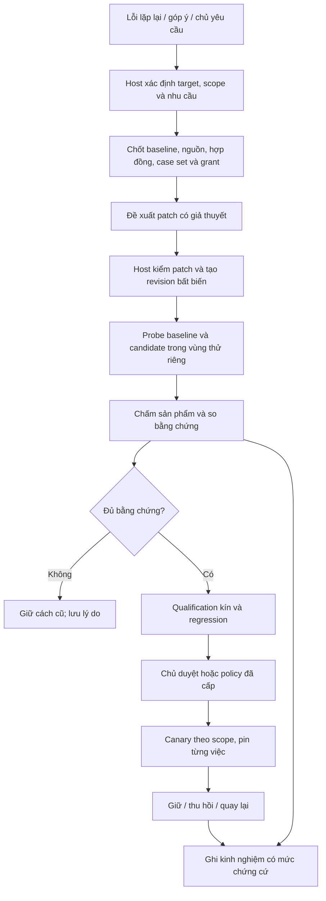

# Spec cải tiến agent và skill bằng thử nghiệm có đối chứng

- Ngày: 22/10/2026, Asia/Saigon.
- Trạng thái: thiết kế đề xuất để chủ sản phẩm review; chưa triển khai, chưa gọi model chạy thử, chưa bật chính sách trên brain nào.
- Nền khảo sát: Javis OS **0.284.0**, `a02e45fcd7c58bb3fde4eac3a850cb87c618621c` trên GitHub `main`. Checkout chính trên máy cũ hơn nền này; khi triển khai phải bắt đầu từ main mới và rà lại điểm tích hợp.
- Chủ sản phẩm: anh. Đối tượng sử dụng: chủ brain, người xây agent/skill và nhóm trợ lý chạy công việc có sản phẩm kiểm được.
- Phạm vi tài liệu: hợp đồng sản phẩm và kỹ thuật từ nền nghiệm thu, bản đầu cho một skill, đến cải tiến agent, gói agent–skill và Team. Mỗi mốc có điều kiện nghiệm thu riêng; tài liệu không cấp lệnh triển khai hoặc chạy pilot thật.
- Tên trong giao diện: **Cải tiến có kiểm chứng**. Tiền tố kỹ thuật đề xuất: `improvement_*`.

**Đường đọc nhanh:** mục 1–4 chốt mục tiêu và nguyên tắc; mục 7–15 mô tả cơ chế; mục 16 là phạm vi mở rộng agent/skill/Team; mục 22–24 là kiểm thử, mốc và pilot. Bản đầu cần M0–M3; các mốc sau mở theo bằng chứng.

## 1. Ý định, kết quả mong muốn và giả định

### 1.1 Yêu cầu đã nhận

Sau nghiên cứu Harness², chủ yêu cầu một spec chi tiết từ đầu đến bản mở rộng cho agent và skill. Giá trị cần tạo ra là: giảm lỗi lặp lại, giảm công chủ phải sửa và giúp Javis giữ lại cách làm có bằng chứng tốt hơn cho những nhiệm vụ tiếp theo.

Không dùng số skill mới, số bài học mới, số lần agent tự review hoặc số token tiết kiệm làm đại diện cho chất lượng. Một hệ học hữu ích có thể quyết định không sửa gì khi cách hiện tại đã tốt hoặc bằng chứng chưa đủ.

### 1.2 Giả định thiết kế

1. Giữ kiến trúc FastAPI, các engine hoán đổi được, MCP Hub, brain dạng file và kho runtime hiện có.
2. Ưu tiên công việc lặp lại có nguồn đầu vào và tiêu chí kiểm rõ: đối soát bảng, báo cáo, tài liệu theo brief, quy trình tổng hợp có cấu trúc.
3. Chất lượng đứng trước tiết kiệm. Không thêm trần tiền mặc định; không tự đổi sang model rẻ hơn, hạ reasoning, bỏ dữ liệu cần thiết hoặc bỏ kiểm chứng.
4. Thử nghiệm dùng đúng engine/model/reasoning do chủ chọn. Engine không hỗ trợ cách ly cần thiết thì báo chưa hỗ trợ cho phép thử đó, không tự đổi engine.
5. Những con số trong tài liệu là chính sách khởi tạo hoặc điều kiện thử nghiệm đề xuất, chưa phải hiệu quả Javis đã đạt.
6. Mỗi mức mở rộng chỉ được bật sau khi mốc phụ thuộc đã đạt. Không coi đồng ý viết spec là đồng ý cho tự sửa mọi agent/skill.

### 1.3 Kết quả người dùng phải nhận ra

- Khi báo lỗi lặp lại, anh thấy Javis đề xuất một thay đổi cụ thể và nói cách kiểm thay đổi ấy.
- Sau phép thử, anh xem được bản cũ/bản mới, điều gì tốt hơn, chỗ nào chưa rõ, phạm vi áp dụng và nút quay lại.
- Khi chạy việc tiếp theo, Javis nạp đúng phiên bản đã được cho phép, không để bài học nhóm này ảnh hưởng nhóm khác.
- Khi bản mới kém đi hoặc dữ liệu/luật thay đổi, hệ ngừng dùng bản không còn hợp lệ và giữ lại lịch sử.
- Hoạt động cải tiến không đánh dấu việc gốc đã xong; sản phẩm vẫn phải qua nghiệm thu của chính việc đó.

## 2. Hiện trạng đã xác minh và ranh giới với các spec khác

| Thành phần hiện có | Tái sử dụng | Khoảng trống của đợt này |
|---|---|---|
| `learn.py` | Model đề xuất manifest, host kiểm và ghi; chống sửa luật chủ, secret/injection scan, khóa brain | Chưa chứng minh bản cập nhật skill/agent tạo ra chất lượng tốt hơn bằng chạy đối chứng |
| `agent_lessons.py`, `agent_review.py` | Bài học có agent/scope/source, review reaction, tự rà soát, thu hồi và nâng phạm vi | Thêm liên kết với revision thử nghiệm, tình trạng kiểm chứng và bằng chứng tác dụng |
| `resonance.py`, `resonance_learning.py`, `resonance_store.py` | Thử phương pháp cũ/mới, revision, holdout, lease, giữ lượt và quay lại | Danh sách `METHODS` cố định; chưa đại diện được một gói sửa skill/agent bất biến |
| `agent_ledger.py`, `usage_store.py`, `usage_index.py` | Sổ lượt thực thi và usage chuẩn | Truyền thêm experiment/trial/case/purpose; không tạo sổ tiền độc lập |
| `team_acceptance.py`, `team_runner.py` | Kiểm sản phẩm, hash, lịch sử, bounded fix, xác nhận chủ | Nghiệm thu còn tùy chọn; sản phẩm chữ và đúng nghiệp vụ cần hợp đồng đủ mạnh |
| `skill_router.py`, `lazy_skill_runtime.py`, `system_sync.py` | Phân giải skill canonical, lazy loading, mirror, bảo vệ skill hệ thống | Phân giải revision hiệu lực theo scope; bằng chứng phiên bản thực sự được cấp vào lượt |
| `agent_rules.py` | Giữ nguyên các dòng chủ sở hữu ngoài vùng Javis quản lý | Kiểm các patch và nguyên tắc chủ trong thử nghiệm lẫn kích hoạt |
| `team_gate.py`, `capability_executor.py`, `turn_context.py` | Danh tính host, grant, tool gate, audit, lease/idempotency | Profile thử chỉ đọc nguồn đã đóng băng, chặn side effect, receipt phiên bản end-to-end |

Tham chiếu bắt buộc: [spec Team chất lượng trước chi phí](2026-10-22-team-quality-first-design.md). Mốc nghiệm thu mặc định và usage ở tài liệu đó là **phụ thuộc dùng chung**, không triển khai lại bằng một bộ hợp đồng, bảng usage hoặc dispatcher khác. Nếu phần phụ thuộc chưa phát hành, pilot đầu vẫn làm được trên tác vụ thử riêng có hợp đồng bắt buộc; chưa được bật tự cải tiến cho mọi việc Team.

Spec này không thay thế học sự kiện, kiến thức cá nhân, reaction, nhịp thức hay phép thử METHODS đang chạy. Nó thêm đường kiểm chứng cho **thay đổi năng lực có thể thực thi**. Tài liệu tiến độ cũ ngày 08/10 không được dùng làm bằng chứng Javis hiện chưa có học theo agent/nhóm.

## 3. Lựa chọn kiến trúc và phạm vi

### 3.1 Các phương án đã cân nhắc

| Phương án | Lợi ích | Hạn chế | Quyết định |
|---|---|---|---|
| Cài toàn bộ Harness² thành một dịch vụ chạy ngoài Javis | Có quy trình nghiên cứu sẵn | Thêm executor, thư viện và luồng state; không kế thừa đủ scope/quyền/engine của sản phẩm | Chỉ dùng làm tham chiếu hoặc đối chứng nghiên cứu |
| Mở rộng hệ học, thử nghiệm và nghiệm thu hiện có | Giữ một đường quyền, usage và danh tính; rollout theo mốc | Cần xây revision/effective view và adapter cách ly | **Chọn** |
| Cho agent tự sửa skill sau góp ý | Nhanh | Khó phân biệt sửa đúng với viết thêm prose; không có đối chứng | Chỉ giữ cơ chế đề xuất hiện có, không gọi là cải tiến đã kiểm chứng |

Mượn Propose–Probe–Compose và kho kinh nghiệm từ Harness². Bổ sung baseline trong lựa chọn cuối, nghiệm thu nghiệp vụ độc lập, kiểm scope, holdout kín, version pin, canary và rollback của Javis.

### 3.2 Bản đầu và bản mở rộng

- **V1:** một skill người dùng, patch nội dung văn bản, một adapter thử được xác minh, snapshot đầu vào, hai ứng viên tối đa, phép thử kín, chủ quyết áp dụng, một scope rõ ràng.
- **V2:** tự áp dụng có điều kiện trong scope chủ đã cấp; mở rộng adapter; kiểm mô tả/điều kiện chọn skill; cải tiến vùng do Javis quản lý trong agent.
- **V3:** gói agent–skill có quan hệ phụ thuộc, script kiểm được, quy trình chỉ đọc/ghi vùng thử, kinh nghiệm dùng lại theo nghiệp vụ và phối hợp Team.
- **V4:** chọn nhu cầu thử theo bằng chứng, compose nhiều gói đã kiểm, chuyển kinh nghiệm có kiểm tra lại giữa scope/engine; quản trị và xuất/nhập gói.

Không bao gồm: huấn luyện trọng số model; tự nâng quyền; tự thay model/reasoning; tự chỉnh core prompt/cổng quyền; tự sửa plugin đang chạy; tự gửi/đăng/thanh toán trong probe; marketplace công khai; tự sửa tiêu chí để bản mới thắng.

## 4. Các bất biến bắt buộc

| Mã | Bất biến |
|---|---|
| I01 | Model chỉ đề xuất thay đổi; host xác minh, ghi revision, chọn scope và kích hoạt bằng giao dịch có điều kiện. |
| I02 | Luật chủ, danh tính, quyền, hợp đồng nghiệm thu và dữ liệu đáp án nằm ngoài bề mặt được sửa. |
| I03 | Baseline và candidate dùng cùng nhiệm vụ, snapshot, grant, engine/model/reasoning, nguồn công cụ và điều kiện thực thi; mọi khác biệt chủ ý phải khai báo. |
| I04 | Luôn giữ baseline trong tập so sánh; không có bằng chứng đủ mạnh thì giữ cách cũ. |
| I05 | Một kết quả tốt hơn không chứng minh mọi chỉnh sửa bên trong đều có ích; không gán nguyên nhân khi chưa tách được ảnh hưởng. |
| I06 | Holdout/đáp án không đi vào prompt improver/solver; nếu đã lộ thì bộ đó hết vai trò holdout. |
| I07 | Trial không gây hành động ngoài thật và không sửa canonical file đang dùng; không nhân bản side effect khi replay/retry. |
| I08 | Kết quả kiểm gắn đúng revision/hợp đồng/nguồn/grant/engine; kết quả tới muộn không được áp vào bản đã đổi. |
| I09 | Cải tiến có phạm vi; không tự vượt brain, agent, team, nghiệp vụ, ngôn ngữ hoặc engine đã kiểm. |
| I10 | Không sửa lượt đang chạy, không đổi file dưới phiên CLI đang resume, không ép reload ngầm giữa một việc. |
| I11 | Dừng, thu hồi quyền, thay luật chủ hoặc nguồn bị xóa có hiệu lực ở cổng chạy kế tiếp và cổng áp dụng. |
| I12 | Unknown, lỗi hạ tầng, thiếu usage hoặc thiếu bằng chứng nạp phiên bản không được biến thành thắng/thua hoặc 0 chi phí. |
| I13 | Tiết kiệm chi phí không hạ tiêu chuẩn hoặc cắt công việc chủ đã giao; khám phá tự phát và nghĩa vụ của việc có đường xử lý riêng. |
| I14 | Mọi kích hoạt và quay lại đều idempotent, có lịch sử; rollback không replay hành động ngoài và không xóa chỉnh sửa mới của chủ. |

## 5. Thuật ngữ và đơn vị so sánh

| Thuật ngữ | Định nghĩa |
|---|---|
| Target | Agent/skill/gói cần cải tiến, có `target_id` ổn định; slug chỉ là tên hiển thị/phân giải. Xóa rồi tạo lại cùng slug tạo target mới. |
| Asset revision | Bản bất biến của một tài sản: bytes, manifest, hash, nguồn và vùng được phép sửa. |
| Bundle | Tập revision agent/skill/helper cùng phụ thuộc; có một manifest hash để pin cả gói. |
| Baseline | Effective bundle thực sự đang dùng trong đúng scope trước phép thử; không mặc định là file trong git hoặc bản phát hành cũ. |
| Candidate | Bundle được host tạo từ patch đã kiểm, dựa trên baseline cụ thể. |
| Case | Nhiệm vụ độc lập có nguồn snapshot, input, hợp đồng chấm, mức quan trọng và nguồn gốc. |
| Case set | Tập case đã khóa version, chia tuning/qualification/regression; không sửa danh sách sau khi thấy kết quả. |
| Trial | Một lần thực thi một bundle trên một case với config và attempt riêng. Có thể phát sinh nhiều request model. |
| Experiment | Quy trình đề xuất–thử–đánh giá một họ thay đổi, chứa các trial và quyết định; không phải một lượt engine. |
| Activation | Quyết định revision/bundle nào có hiệu lực cho scope nào, trên cấu hình nào, từ generation nào. |
| Recipe | Kinh nghiệm chuyển giao gồm điều kiện, thao tác cải tiến và bằng chứng; không tự là một activation hay luật chủ. |

Ba lớp kết luận tách riêng:

1. **Execution valid:** đúng cấu hình và cách ly, đã chạy, đã nhận sản phẩm và receipt cần thiết.
2. **Product accepted:** sản phẩm đúng hợp đồng của case; kiểm máy chỉ khẳng định phần nó kiểm được.
3. **Improvement eligible:** so sánh đủ căn cứ để thay baseline trong phạm vi đã khai.

Một trial hợp lệ có thể làm sản phẩm sai. Một sản phẩm đúng có thể chưa chứng minh candidate hơn baseline.

## 6. Luồng tổng thể và chủ sở hữu quyết định



Host kiểm và chọn bộ case, evaluator và policy. Improver nhận nguồn tuning được phép đọc cùng trace đã lọc; nó không có quyền ghi canonical, đọc đáp án, thêm capability hoặc kích hoạt. Solver chỉ nhận effective bundle và nguồn của trial. Evaluator nhận hợp đồng và đáp án riêng. Chủ giữ quyền đặt yêu cầu, luật, model, phạm vi tự áp dụng, nghiệm thu nội dung và ngoại lệ.

## 7. Nền nghiệm thu và dữ liệu thử

### 7.1 Hợp đồng bắt buộc cho trial

Mọi experiment phải có hợp đồng trước khi gọi engine. Hợp đồng gồm `contract_version/hash`, tiêu chí bắt buộc, tiêu chí nghiệp vụ, metric chính, hướng tốt hơn, cách tổng hợp, evaluator version/hash và điều kiện unknown. Không tự suy tiêu chí nghiệp vụ bằng việc đếm chữ hoặc có từ khóa.

Tái sử dụng `team_acceptance` qua adapter chấm; bổ sung evaluator độc lập cho những cấu trúc chưa được hỗ trợ. Không tạo Team job thật chỉ để tận dụng checker. `command_ok` chỉ chạy checker do host/chủ đăng ký, trong môi trường đọc sản phẩm và đáp án; solver không sửa được executable, dependency, fixture hoặc biến môi trường của checker.

Với sản phẩm chữ, hash toàn bộ bytes hoặc manifest nội dung chuẩn hóa theo policy đã pin. `owner_confirm` gắn đúng output hash và case; quyết định ở tab cũ nhận `stale_version`. Nội dung đầu ra chứa lệnh dành cho reviewer được coi là dữ liệu, không có quyền sửa rubric.

### 7.2 Snapshot nguồn

Snapshot là bản đủ để tái hiện bài toán, không phải chỉ vài câu trích. Manifest giữ `brain_id`, source ref/version, thời điểm lấy, timezone, quyền đọc, freshness, schema và hash bytes. Nguồn thay đổi theo thời gian ghi rõ kỳ dữ liệu và cutoff; mọi nhánh dùng cùng bản đã đóng băng.

V1 dùng file snapshot và tool chỉ đọc fixture. V2 thêm replay của tool đọc với key `(capability_id, canonical_args_hash, snapshot_version, grant_hash)`. Thiếu response tương ứng trả `fixture_miss`, không rơi về gọi production. Không replay lời gọi ghi hoặc giả biên nhận thành công. Bài toán phải kiểm tương tác live thì tách thành loại test riêng, không gộp vào đối chứng trên snapshot.

Secret được loại bỏ trước khi snapshot đi vào ngữ cảnh model. Dữ liệu nhạy cảm đủ điều kiện đọc được lưu theo quyền brain, mã hóa bằng cơ chế evidence hiện có; redaction không được làm bài toán mất nghĩa mà vẫn gọi là tái hiện được. Không tái hiện được thì `insufficient_source`.

### 7.3 Tách tập và chống học thuộc

- **Tuning:** cho improver đọc case, trace và lỗi; dùng để chọn patch hoặc compose.
- **Qualification:** host giữ kín, chỉ chạy sau khi chọn đúng một candidate cuối; không đưa đáp án hay lỗi từng case cho vòng đề xuất hiện tại.
- **Regression:** các năng lực cũ phải giữ được, có case âm, case không nên gọi skill và luật chủ quan trọng; không dùng thay qualification.
- **Live canary:** công việc thật sau khi activation có điều kiện; không biến một việc thật thành nhiều lần gửi/đăng thử.

Chia theo họ nhiệm vụ/nguồn/người nhận/kỳ dữ liệu, không random các dòng gần giống vào hai tập. Dedupe bằng hash và group key do host khai; bản paraphrase của cùng nguồn không được coi là case độc lập. Split được khóa trước thử; `seed` chỉ tái lập việc chia/đổi thứ tự, không bảo đảm sampling model giống nhau.

Qualification chỉ được tiêu thụ một lần cho một họ thử nghiệm. Trạng thái `unseen -> reserved -> consumed` ghi bền trước khi lộ kết quả. Đã dùng để quyết định giữ/sửa thì không còn là holdout cho candidate sau; cần bộ mới. Người tạo patch không được đọc fixture chứa đáp án qua filesystem, tool, web hoặc thư viện kinh nghiệm. Mất ranh giới này đánh dấu `contaminated` và không cho kết luận hơn baseline.

### 7.4 Quy mô kiểm ban đầu

| Mục đích | Quy mô tối thiểu đề xuất | Ý nghĩa |
|---|---|---|
| Feasibility V1 | 6 case tuning, 6 case qualification, 6 case regression độc lập | Chứng minh đường chạy và phát hiện lỗi; chưa đủ để tự mở rộng |
| Pilot xác nhận một nghiệp vụ | 12 tuning, 20 qualification kín, 12 regression | Một baseline và một candidate cuối; điều kiện phát hành ở mục 13 |
| Nghiệp vụ khác/engine khác | Case set riêng theo cấu hình mới | Không kế thừa nhãn thắng từ pilot trước |

Một case có nhiều dòng vẫn là một đơn vị thống kê. Không đủ dữ liệu độc lập thì báo giới hạn và chỉ cho chủ thử thủ công phạm vi nhỏ, không tự sinh case giả để đủ cỡ mẫu. Synthetic case có nhãn riêng, dùng cho kỹ thuật/regression, không thay bằng chứng nghiệp vụ thật.

## 8. Trigger, policy và chống nhiều hệ cùng sửa

### 8.1 Nguồn mở đề xuất

1. Chủ chọn Cải tiến skill/agent hoặc giao bằng chat, hệ phân giải target/scope rõ ràng.
2. Cùng loại lỗi nghiệm thu lặp ở ít nhất hai nhiệm vụ độc lập, cùng target và cấu hình hiệu lực.
3. Chủ có góp ý nội dung chỉ rõ lỗi; một góp ý đủ mở đề xuất, chưa đủ xác nhận nguyên nhân hoặc tự áp dụng.
4. Review hiện có phát hiện bước thiếu/sai với trace; nó gửi proposal vào đường này.

Emoji, nhiều agent đồng tình, usage cao, “lâu chưa cải tiến” hoặc ngày mới không tự mở probe. V4 chỉ ưu tiên trong những trigger đã có nguồn; không định kỳ quét toàn bộ brain rồi viết lại hàng loạt.

### 8.2 Các mức điều khiển

| Policy | Đề xuất | Chạy thử | Áp dụng |
|---|---|---|---|
| `off` | Không tạo mới | Không | Không; trạng thái activation hiện có xử lý theo mục 18 |
| `suggest` | Có khi có tín hiệu | Chỉ khi chủ yêu cầu phép thử cụ thể | Chủ quyết |
| `trial` | Có | Tự thử trong scope/nguồn đã cấp | Chủ quyết |
| `auto_scoped` | Có | Có khi đủ điều kiện | Chỉ loại thay đổi/scope đã cho phép và vượt mọi gate |

Mặc định brain cũ/mới là `suggest`; migration không lấy công tắc Auto/Cộng hưởng/Toàn quyền sẵn có làm quyền tự cải tiến. Chọn `trial` hoặc `auto_scoped` một lần cho phạm vi đủ rõ là đủ, không hỏi lại từng rollout. Mở sang brain/team khác, executable helper, thay mô tả định tuyến hoặc thay cấu trúc cần quyền tương ứng trong policy.

Trong `suggest`, host chỉ gom trigger và tạo thẻ đề xuất bằng code từ bằng chứng đã có; không tự gọi improver để viết patch hoặc tự chạy solver. Chủ yêu cầu tạo patch/chạy thử cụ thể mới cho phép các lượt tương ứng. Quy tắc này áp dụng đường cải tiến mới, không tắt các lượt học/hội thoại vốn đã được chủ cho phép ở phần khác của Javis.

Policy host giữ `policy_version`, owner principal, target allowlist, scopes, allowed_surface, allowed_engines, sources, apply_mode, canary allocation, operational limits và retention. Candidate không được sửa policy. Quyền trial luôn là giao giữa quyền hiện tại và profile thử nghiệm; `full` ở việc thật không cấp quyền side effect cho probe.

### 8.3 Một cơ chế ghi cho mỗi tài sản

Các đường `learn.py`, review, chat chỉnh file, system/pack sync và bộ cải tiến phải cùng gọi guard revision/invalidation. `learn.py` vẫn học memory/wiki bình thường. Khi target đã được chủ đưa vào đường cải tiến có kiểm chứng, proposal thay đổi hành vi agent/skill của nó được stage thành candidate, không đồng thời ghi thẳng vào bản live.

Không tạo vòng học ngược: trial/compose/review không trở thành hội thoại production để tự tạo thêm nhiệm vụ hoặc lesson; gắn `learning_origin=trial|compose|qualification` và lọc ở mọi hook học. Host biết sự kiện này từ ledger/turn binding, không tin marker model tự viết.

Một experiment đang mở trên cùng `(brain_id, target_id, base_bundle_hash, scope_hash, failure_signature, engine_config_hash)` dùng chung idempotency key. Một lease điều phối cho mỗi target/scope; cấp brain-wide xung đột mọi scope con. Ngoài lease, mọi ghi dùng generation/CAS; không giả định khóa Python bảo vệ nhiều process.

## 9. Phiên bản tài sản và bề mặt được sửa

### 9.1 Revision bất biến và effective view

Canonical của user vẫn là `skills/<slug>/SKILL.md`, `agents/<slug>.md` và các file chủ sở hữu. Host nhập nội dung hiện tại thành baseline revision và manifest phụ thuộc. Candidate lưu ngoài canonical trong state; không ghi đè file chủ để chạy thử.

Activation trỏ revision overlay theo scope. Mỗi lượt dùng **effective view** = canonical đã pin + các overlay hợp lệ được chọn + luật/policy/grant host. Resolver chung phải phục vụ đồng nhất:

- skill index/router và lazy loading;
- `javis_use_skill`/đọc helper qua hub;
- persona/lesson của chat agent, goal và Team;
- nội dung materialize cho engine native, gồm mirror `.claude/skills` của riêng lượt;
- telemetry và bản giải thích đang dùng phiên bản nào.

Không ghi overlay scope nhóm A vào canonical dùng toàn brain hoặc mirror global. Mirror là dữ liệu phái sinh, không phải nguồn revision. V1 chỉ enable adapter chứng minh được effective view; giao diện không cho bật ở đường nạp chưa được phủ.

Ownership map được host khóa cùng baseline: vùng chủ bảo vệ, vùng Javis quản lý, vùng chủ cho phép cải tiến. Không để model suy ra “đoạn này chắc do AI viết” để tự nhận quyền sửa. Skill cũ chưa có ownership map chỉ được tạo bản diff đề xuất; chủ chọn vùng được sửa hoặc xác nhận diff trước activation. Agent mặc định chỉ mở vùng bổ sung Javis đã quản lý.

Thứ tự phân giải: đúng brain -> đúng target -> đúng agent/team/context -> domain/language/channel/engine selector chủ đã khai. Activation cùng target có scope chồng nhau phải có quan hệ specificity rõ; nếu hai bản cùng mức ưu tiên cùng khớp thì `activation_conflict`, giữ baseline và báo chủ. Không chọn ngẫu nhiên hoặc theo thời điểm cập nhật.

### 9.2 Bề mặt skill

| Loại thay đổi | Mốc | Điều kiện |
|---|---|---|
| Thêm/sửa bước, checklist, pitfall trong thân skill người dùng | V1 | Patch nhỏ theo giả thuyết; bảo toàn phần khóa/luật chủ |
| Mô tả, điều kiện chọn skill, ví dụ chọn/không chọn | V2 | Tập intent dương/âm; kiểm routing và cạnh tranh với skill khác |
| Tách/gộp skill, thay phụ thuộc | V3 | Định danh/phụ thuộc rõ, migration alias, kiểm gọi cũ và permission intersection |
| Thêm/sửa script/helper | V3 | Runtime cách ly, allowlist, kiểm mã và test helper; chủ cấp quyền cho loại executable |
| Skill hệ thống hoặc do pack quản lý | Đề xuất maintainer | Không tự ghi bản bundled; owner có thể tạo override có nguồn/version rõ |

`name/slug`, trạng thái enabled, group, ownership, scope và quyền không do improver tự đổi. `description` là bề mặt behavior riêng, không được sửa lén trong một candidate chỉ khai body. Khi helper mới chưa đi kèm đủ dependency hoặc đường dẫn ngoài manifest, validator từ chối.

### 9.3 Bề mặt agent

V2 cho thay vùng bổ sung do Javis quản lý hoặc procedure overlay riêng: cách lập kế hoạch, kiểm nguồn, trình bày, tự kiểm theo nghiệp vụ và hướng dẫn dùng skill đã được cấp. Giữ `agent_key`, role/đích chủ đặt, luật chủ, model/provider/reasoning, lịch, quyền, công tắc Auto và tài sản riêng.

`agent_rules.missing_owner_lines` là một guard dùng lại, không phải bằng chứng duy nhất rằng ý nghĩa luật không đổi. Patch thêm câu đối nghịch luật chủ vẫn phải bị chặn, dù chữ gốc còn nguyên. Các trường protected được host loại khỏi patch schema; reviewer độc lập kiểm mâu thuẫn nội dung; mâu thuẫn chưa rõ thì chờ chủ.

Đổi danh sách skill, phân vai hoặc thứ tự workflow chỉ có ở V3 và chỉ tham chiếu năng lực nằm trong grant. Đây là thay đổi cấu trúc, cần loại quyền riêng. Giữ mọi phần hand-written ngoài vùng cho sửa; không viết lại toàn bộ file từ tóm tắt persona.

### 9.4 Patch manifest

Mỗi patch có `base_bundle_hash`, asset id/revision, path chuẩn, before hash, operation, vùng sửa, diff, giả thuyết, failure signature, expected_behavior, possible_regressions và evidence refs. Host tính hash và revision mới; model không tự khai hash thành bằng chứng.

V1 mỗi candidate thay đúng một thành phần chính. Hai góc đề xuất: **cách thực hiện** và **quy trình nghiệp vụ**; tối đa hai candidate trên một experiment. `KEEP_BASE` là kết quả hợp lệ. Không thêm văn bản chung kiểu “hãy cẩn thận” nếu không giải thích được hành vi và phép kiểm sẽ thay đổi.

## 10. Hợp đồng executor và cách ly

### 10.1 Interface host tối thiểu

Tên dưới đây là hợp đồng thiết kế; kế hoạch triển khai chốt chữ ký Python cụ thể trên main mới:

| Interface | Đầu vào/đầu ra bắt buộc |
|---|---|
| `capture_target` | Target+scope+principal -> baseline manifest, owner rule hash, source versions |
| `validate_patch` | Baseline+patch+surface policy -> rejected hoặc immutable bundle |
| `prepare_trial` | Bundle+case snapshot+grant+engine pin -> isolated workspace và effective view receipt |
| `execute_trial` | Trial id+workspace+deadline -> event stream, artifact manifest, actual config, ledger refs |
| `evaluate_trial` | Artifact refs+contract pin+checker pin -> criterion verdicts, evidence, unknown reasons |
| `compare_experiment` | Complete trial pairs+decision policy -> eligible/rejected/inconclusive, reasons |
| `activate_bundle` | Expected generation+qualified bundle+scope+policy -> activation event hoặc conflict |
| `revert_activation` | Expected generation+target+reason -> prior compatible bundle hoặc suspended |

Các thao tác chạm kho/file chạy ở đường offload hiện có; tick event loop chỉ tìm việc/claim và spawn tác vụ cần model. Không import `main.py` từ module mới; inject dependencies theo mẫu repo.

### 10.2 Workspace và nguồn

Mỗi `(experiment, variant, case, repeat, attempt)` có output root riêng và cấu hình native riêng. Nguồn case được mount/copy chỉ đọc; không dùng symlink/junction trỏ vào brain live. Checker, answer store, canonical agent/skill và kho state production không nằm trong vùng solver đọc/ghi. Workspace không mang token login hoặc biến môi trường dư thừa của server.

Blob nhạy cảm được giải mã vào vùng tạm có quyền truy cập hạn chế chỉ trong thời gian trial cần dùng, rồi dọn bằng journal có recovery khi crash. Receipt/report trỏ evidence được quản lý, không công bố đường tạm hoặc nhúng raw source. API credential dùng ở host theo đường engine hiện có, không copy vào workspace để solver gọi provider hay production trực tiếp.

Mỗi trial khởi tạo context sạch. CLI không resume session sản phẩm hoặc session của candidate khác. Proxy MCP của trial chỉ nhận turn key do host cấp, chỉ có fixture/read capability đã pin và công cụ ghi output trong sandbox; không chỉ dựa vào lời nhắc “không gửi tin”. Native shell/web/connector phải được chặn tương đương ở engine.

V1 ưu tiên adapter API có tool inventory host kiểm soát. Đây là lựa chọn adapter đầu tiên, không tự chuyển người dùng sang API: khi model anh chọn chưa có adapter đạt, UI ghi chưa hỗ trợ thử tự động cho engine này. Adapter Claude/Codex hoặc engine khác chỉ enable sau ma trận kiểm cách ly riêng. Không xem `team_gate` mode gated là đủ cho trial vì mode đó vẫn có đường duyệt hành động ngoài; trial luôn cấm side effect.

### 10.3 Receipt và độ phủ

Host ghi `trial_id`, `engine_session_id`, provider/model/reasoning được yêu cầu và thực tế, native version nếu quan sát được, prompt/effective bundle hash, skill selection refs, tool inventory hash, fixture hash, grant hash, artifact hash và trạng thái kết thúc. Cấu hình thực tế không xác minh được có trường `coverage=unknown`; không giả định model alias bất biến.

Tách ba tín hiệu: `available` (đã cấp vào view), `selected` (router/tool chọn), `observed_use` (host có sự kiện gọi/đọc phù hợp). Không có sự kiện `javis_use_skill` không chứng minh engine native không đọc skill. Không suy khả năng model hiểu/tuân thủ từ receipt. Thử sửa body cần đủ bằng chứng phiên bản mới đã được cấp theo đường dự kiến; thiếu thì `unverified_installation`, chưa kết luận patch vô ích.

Nếu adapter có server/tool/session cache, key phải chứa effective bundle generation; test phải chứng minh lần sau không nạp nhầm bản cũ. Đổi activation giữa các lượt của cùng một việc chỉ có hiệu lực từ việc mới hoặc điểm nối đã chủ cho phép; turn đang chạy tiếp tục với bundle đã pin.

## 11. Quy trình đề xuất, probe và compose

### 11.1 Chuẩn bị baseline

Host chốt toàn bộ cấu hình và case set trước probe. Baseline chạy bằng effective bundle production đã snapshot; không tối giản bớt skill/luật để candidate dễ thắng. Hai nhánh có cùng quyền và mức tài nguyên thực thi. Wall timeout là giới hạn vận hành đã pin, không là trần tiền; output bị timeout vẫn giữ artifact nhưng verdict có thể unknown theo hợp đồng.

Trên tuning, chạy baseline trước để improver có trace quan sát được. Trace giữ thời điểm, tool call/result, artifact refs và lỗi có ích; loại secret, nội dung ngoài quyền và chỉ dẫn không thuộc nhiệm vụ. Không yêu cầu chain-of-thought riêng tư. Bản lỗi hạ tầng được đánh dấu riêng, không dùng làm bằng chứng deficiency của skill.

### 11.2 Đề xuất và kiểm patch

Improver nhận baseline, failure pattern, nguồn tuning, case contract công khai, các trace được cấp và recipe phù hợp. Nó trả tối đa hai patch có manifest theo mục 9.4. Host kiểm đường dẫn/ownership/surface, schema/frontmatter, luật chủ, phụ thuộc, injection/secret, enabled state và khả năng nạp. Sai cấu trúc được một lần yêu cầu sửa; vẫn sai thì candidate rejected, giữ baseline.

Không gộp việc sửa dữ liệu nguồn với sửa skill. Phát hiện nguyên nhân là thiếu quyền, MCP lỗi, dữ liệu sai hoặc model không hỗ trợ thì ghi `not_a_target_defect` và trả đúng đường xử lý; không vá prompt để che lỗi hạ tầng.

### 11.3 Probe và bằng chứng đối chứng

Mỗi candidate chạy cùng tuning cases. Kết quả được ghép theo case/repeat; thứ tự candidate/baseline được đảo bởi host để hạn chế ảnh hưởng vị trí/thời gian. Mỗi nhánh có workspace riêng, không thấy output/lesson của nhánh kia và không đọc production memory mới phát sinh sau snapshot.

V1 feasibility một repeat/case để kiểm đường đi. Pilot nghiệp vụ và qualification dùng hai repeat độc lập/case cho cả hai bên với cùng policy. Case của một variant chỉ được `pass` khi cả hai repeat đạt phần bắt buộc. Có fail và pass giữa repeat thì `unstable`; critical unstable không đủ điều kiện tự áp. Không tuyên bố đã loại hết tính ngẫu nhiên chỉ vì chạy hai lần.

Chi phí/usage, thời gian, số lần sửa và số request được đo đầy đủ nhưng đứng sau chất lượng. Không dừng nhánh candidate ngay khi có output đẹp hoặc dừng baseline sớm hơn để tạo lợi thế. Retry theo chính sách lỗi hạ tầng ở mục 18, không chạy lại một output sai chỉ để lựa ra output đúng.

### 11.4 Compose

V1 mặc định chọn một candidate hoặc baseline. Nếu hai patch độc lập có bằng chứng hỗ trợ, host có thể mở một compose ở chế độ chủ đã cho phép. Compose tạo **bundle mới**, không mặc nhiên thừa hưởng nhãn đạt của từng phần; bundle mới phải probe trên tuning và chạy qualification/regression riêng.

Compose trả mỗi quyết định `kept|revised|dropped`, thành phần bị tác động và đoạn trace chứng minh. Không nối mọi câu hay vào prompt. Hai patch sửa cùng một bước có xung đột thì giữ một hoặc chỉnh thành giả thuyết mới; không tính phiếu agent. Mỗi experiment tối đa một vòng compose ở V1–V3; vòng tiếp theo là experiment mới với evidence mới.

### 11.5 Chọn đầu ra và chọn cấu hình

Reviewer xem output ẩn danh với ID do host xáo trộn; baseline luôn có mặt. Reviewer không nhìn nhãn “mới”, tên model đề xuất hoặc lời quảng cáo patch. Nó được đọc brief/nguồn cần thiết để chấm, không được thực thi script trong output. Hai reviewer bất đồng ở tiêu chí cần phán đoán thì chủ phân xử; không lấy đa số model cùng họ làm chứng cứ độc lập.

Đầu ra được chọn trong tuning chỉ giúp chọn candidate cuối. Việc kích hoạt cấu hình phải qua qualification kín và policy. Kết quả tốt do một lần đoán đúng không đủ kết luận patch chuyển giao được. Output thắng ở thử nghiệm không tự thay bản giao thật; muốn dùng nó cho việc thật cần nghiệm thu và nguồn còn hợp lệ của việc đó.

## 12. State machine và định nghĩa kết cục

### 12.1 Experiment

```text
proposed -> preparing -> proposing -> probing -> comparing
         -> qualifying -> awaiting_apply -> canary -> completed

Từ bước trước activation có thể tới:
rejected | inconclusive | blocked | cancelled | stale

Trong canary:
completed(kept) | completed(reverted) | blocked | cancelled
```

| Trạng thái | Ý nghĩa và quyền chạy tiếp |
|---|---|
| `proposed` | Có trigger/target, chưa giữ case hoặc gọi model; chủ có thể bỏ qua |
| `preparing` | Chốt source/config/case/grant và baseline; thiếu điều kiện -> blocked có reason |
| `proposing` | Improver chỉ đang tạo patch; chưa có quyền ghi live |
| `probing` | Chạy tuning; kết quả sai vẫn được ghi như kết quả |
| `comparing` | Đánh giá và chọn tối đa một candidate cuối, có thể giữ baseline |
| `qualifying` | Candidate cuối đã khóa; qualification và regression không được dùng để sửa tiếp trong experiment này |
| `awaiting_apply` | Đủ gate nhưng policy cần chủ quyết hoặc chờ thời điểm không có việc đang pin bản cũ |
| `canary` | Activation phạm vi thử đang có hiệu lực cho việc mới; theo dõi đủ cửa sổ |
| `completed` | Kết cục là kept/reverted/kept_baseline; không đồng nghĩa việc nghiệp vụ đã xong |
| `rejected` | Có căn cứ patch sai, vi phạm hoặc kém hơn; không activate |
| `inconclusive` | Cặp chưa đủ, nhiễu, unknown hoặc không chứng minh hơn; giữ baseline |
| `blocked` | Thiếu nguồn/quyền/quota/adapter/reviewer hoặc hạ tầng; chỉ resume khi điều kiện thay đổi |
| `cancelled` | Chủ/hệ chính sách dừng; không tự tạo experiment kế tiếp cùng trigger |
| `stale` | Base, luật, scope, config hoặc contract đã đổi; cần chụp lại và experiment mới |

`blocked` giữ `resume_from` và blocker version; không tự gọi model kiểm tra lại liên tục. `verdict` lưu riêng `eligible|rejected|inconclusive`; eligibility chỉ là điều kiện, không là lệnh áp dụng.

### 12.2 Trial và activation

Trial: `reserved -> prepared -> running -> evaluating -> completed`; kết thúc thay thế: `failed|unknown|interrupted|cancelled|not_run`. `failed` là lỗi execution; sản phẩm sai hợp đồng vẫn có thể là trial completed với criterion fail. Mốc `engine_started` là ranh giới đối soát usage, không suy từ output text.

Activation: `pending -> canary -> active`; nhánh dừng `reverted|suspended|retired`. Generation tăng mỗi lần thay pointer/policy; event log giữ toàn bộ. Experiment có thể completed nhưng activation vẫn active, không dùng một cột trạng thái cho cả hai đối tượng.

## 13. Quy tắc đánh giá và đủ điều kiện áp dụng

### 13.1 Thứ tự ra quyết định

1. Vi phạm quyền, dữ liệu, luật chủ, tiêu chí bất biến hoặc sửa checker: loại candidate và đóng đường tự áp.
2. Không xác minh được đúng source/config/effective view hoặc thiếu cặp: inconclusive/blocked, không kết luận thắng.
3. Một critical criterion fail/unstable mà baseline đạt: rejected cho phạm vi đó.
4. Regression làm mất một năng lực bắt buộc mà baseline giữ được: rejected; không dùng điểm tổng cao hơn để bù.
5. Qua các gate trên mới so metric chính đã chốt: đúng nghiệp vụ trước, sau đó công sửa của chủ, rồi thời gian/usage.
6. Nếu chỉ tương đương chất lượng, không gắn nhãn tăng chất lượng. Có thể đề xuất tối ưu thời gian riêng nếu đó là metric đã được chủ chọn trước và không làm giảm chất lượng.

Verdict criterion gồm `pass|fail|unknown`. Review model là bằng chứng cho tiêu chí chủ cho phép chấm bằng model, không thay lời xác nhận chủ hoặc kiểm số liệu xác định. Unknown không phải fail để làm xấu baseline, cũng không được bỏ khỏi mẫu để làm đẹp candidate.

### 13.2 Gate pilot một nghiệp vụ

Điều kiện khởi tạo cho **tự áp dụng có điều kiện**, được pin trong `decision_policy=v1`:

- Có ít nhất 20 case qualification độc lập, đủ cặp baseline/candidate, hai repeat mỗi variant; toàn bộ critical cases và 12 case regression được chấm.
- Không có vi phạm bất biến, không có regression quan sát được ở tiêu chí bắt buộc; candidate không làm case baseline-pass thành fail/unknown/unstable.
- Primary endpoint và evaluator đã khóa trước chạy. Với tiêu chí nhị phân: `W` là case baseline fail nhưng candidate pass, `L` ngược lại. Tie loại khỏi phép kiểm thống kê nhưng vẫn tính vào tổng coverage; case có unknown/unstable không bị âm thầm bỏ, khiến bộ qualification chưa đủ.
- Có ít nhất 5 discordant cases (`W+L >= 5`) và kiểm dấu nhị thức chính xác một phía với `H0: P(win) <= 0.5`, `p <= 0.05`; đồng thời không có `L` ở tiêu chí bắt buộc. Công thức: `sum(comb(W+L, i) * 0.5**(W+L) for i in range(W, W+L+1))`.
- Với primary endpoint về nội dung/công sửa, tiêu chí win/loss/tie và người chấm được chốt trước, vẫn dùng cặp độc lập; không đổi từ correctness sang tốc độ sau khi xem điểm.
- Nếu kiểm nhiều họ candidate/cấu hình bằng cùng bộ qualification, khai trước số phép kiểm `M` và dùng ngưỡng `0.05/M`; mặc định chọn một candidate cuối, `M=1`. Không mở thêm lần kiểm tới khi có p đẹp.

Đây là gate bảo thủ cho pilot, không là bảo đảm tổng quát. N=20 ít và case có thể còn phụ thuộc; báo cả bảng từng case, số W/L/tie/unknown và khoảng bất định của tỷ lệ. Chưa đủ discordant hoặc baseline đã gần trần thì kết luận inconclusive cho cải thiện chất lượng. Chủ có thể chọn thử thủ công một scope hẹp nhưng không hiển thị candidate đó là “đã chứng minh tốt hơn”.

### 13.3 Gate thực thi và chất lượng có chủ quyết

Tự áp chỉ khi policy cho phép đúng surface và scope, target/grant/contract chưa đổi và có điểm canary. Subjective criteria cần chủ xác nhận thì ở awaiting_apply, không ép thành tự động vì statistical gate đạt ở phần cấu trúc. Một acceptance pass về file/JSON không đủ để vượt gate nội dung.

Canary chưa đủ việc hoặc không đủ chứng cứ thì vẫn là canary/insufficient_observation; hết cửa sổ không tự thành active. Không dùng kết quả ở một ngôn ngữ, một engine hoặc một loại tài liệu để gắn nhãn toàn agent.

## 14. Áp dụng, canary và quay lại

### 14.1 Phạm vi activation

Scope chứa `brain_id`, target ids, `agent_key` nếu có, context (`dm:<agent_key>` hoặc `team:<team_id>`), domain contract, language/channel selectors và engine config/capability profile. V1 khởi tạo bằng selector chủ chọn, không dùng vài keyword để tự cấp phạm vi.

Active skill overlay cho một agent không tác động người dùng/agent khác cùng gọi slug đó. Gói brain-wide chỉ được áp bằng hành động rõ của chủ, đi kèm kiểm regression toàn phạm vi dự kiến. Không tự promote sang `*` dựa chỉ vào hai reaction hoặc số lần bài học được nạp.

### 14.2 Canary

Mặc định đề xuất **10% công việc mới đủ điều kiện**, bucket xác định theo task/session key và policy salt; pin một bundle cho toàn việc. V1 chủ có thể chỉ định một pilot context thay vì lấy 10% nếu lượng việc thấp. Các case thử tổng hợp không tính là live canary.

Cửa sổ chuẩn: tối thiểu 7 ngày **và** 10 nhiệm vụ đủ điều kiện, có dữ liệu nghiệm thu. 14 ngày chưa đủ mẫu thì hỏi chủ giữ canary/thu hẹp/kết thúc quan sát, không tự tăng allocation. Việc gấp, không tái hiện được, cần hành động ngoài nhạy với phiên bản hoặc thiếu hợp đồng không tự vào canary. Đây là selector hợp lệ do chủ chọn, không là lý do bỏ kiểm sản phẩm.

Canary chỉ thực thi một phương án cho một việc thật. Không tự A/B việc gửi tin/thanh toán bằng hai hành động thật. So sánh chất lượng live dựa hợp đồng từng việc và nhóm đối chứng cùng eligibility; quan hệ quan sát khác với cặp replay, báo riêng. Nếu cần tái hiện lỗi, chụp dữ liệu đã được phép để thử offline sau đó.

Mỗi gate chuyển canary sang active phải đánh giá lại grant/source/owner rules. Chủ chưa quyết khi thiếu mẫu thì giữ allocation hiện tại, hiện insufficient_observation và chỉ nhắc khi cần hành động; không tự tăng allocation hoặc mở thêm phép thử để bù số lượng. Nếu source/evidence không còn đủ để giám sát, suspend theo gate riêng thay vì coi im lặng là chấp nhận.

### 14.3 Kích hoạt nguyên tử

Activation transaction kiểm `expected_generation`, base canonical hash, dependency hash, owner_rule_hash, policy/grant version, target còn sống và experiment eligible. Unique active selector tránh hai pointer đồng thời. Outbox ghi cùng transaction để refresh router/UI; outbox lỗi không được khiến pointer áp hai lần.

Materialized view được dựng sẵn ở thư mục version riêng, fsync/atomic rename theo nền tảng, rồi verify manifest trước khi pointer active. Nếu file store và DB không giao dịch chung, dùng `pending_materialization -> ready -> pointer_commit`, startup đối soát; resolver chỉ đọc pointer có view ready đúng hash. Không “ghi nửa gói” rồi để engine load.

Mỗi request có `decision_key`: gửi lại cùng key cùng payload trả kết quả trước; cùng key khác payload trả 409. Khi canonical bị chủ sửa, không tự merge patch cũ vào file mới; suspend overlay phụ thuộc và cần rebase + qualification mới.

### 14.4 Tín hiệu quay lại

- Một vi phạm quyền/luật chủ hoặc critical regression xác minh được và gắn đúng bundle: suspend ngay mọi activation liên quan; không chờ đủ mẫu.
- Hai nhiệm vụ độc lập thất bại cùng failure signature mới, có source/config đủ để quy về phạm vi candidate: suspend canary, mở review; mặc định quay lại prior compatible bundle khi prior còn hợp lệ.
- Chủ bấm Quay lại: có hiệu lực cho việc mới ngay sau transaction; việc đang chạy theo pin cũ được đánh dấu và xử lý theo yêu cầu dừng của chủ.
- Chỉ số mềm như reaction, độ dài, thời gian hoặc chi phí tăng: mở review, không tự kết luận regression nghiệp vụ.

Prior cũng có thể đã mất quyền, bị sửa hoặc không tương thích. Khi đó `suspended_no_compatible_baseline`, dùng canonical hiện tại nếu qua guard; nếu không, chờ chủ. Không dùng rollback để khôi phục quyền đã thu hồi hoặc viết đè canonical mới. Rollback đổi pointer; sản phẩm đã bàn giao giữ lịch sử, không tự làm lại/gửi lại.

## 15. Kho kinh nghiệm và học giữa các nhiệm vụ

### 15.1 Bản ghi đầy đủ

Recipe có `cue`, thao tác, target component, applicability, exclusion, before/after refs, experiment/trial/trace refs, verdict, confidence_basis, owner_rule_hash, engine profile và ngày kiểm. Verdict chuẩn: `helped|hurt|no_observed_effect|confounded|untested`.

- Chỉ có nhiều thành phần cùng đổi hoặc một lần chạy chưa tách tác dụng: `confounded`.
- Candidate không được chọn vẫn có thể cung cấp evidence về một thay đổi có ích; lưu được nhưng không tự activate.
- Selection thắng không tự nâng confidence hoặc chuyển `confounded` thành `helped`.
- Không có bài học có thể chuyển giao thì ghi `NO_ENTRY`; giữ raw decision evidence, không ép sinh prose.

Tách **facts của workspace** khỏi **procedure có thể dùng lại**. Mapping mã/số tiền/ngày hạn của nhiệm vụ cũ không trở thành facts đúng cho nhiệm vụ mới. Recipe chỉ nhắc thao tác kiểm và nguồn cần đọc lại. Fact có phạm vi và freshness riêng, vẫn đi qua đường memory/wiki hiện có.

### 15.2 Liên kết với agent_lessons

`agent_lessons` giữ lesson đang dùng; revision/experiment giữ bằng chứng chi tiết. Thêm linkage host `lesson_id -> recipe_id/experiment_id/bundle_hash`, không chép toàn bộ trace vào lesson text 300 ký tự. Nhãn nguồn cần phân biệt “chủ dặn”, “agent tự rút”, “đã thử có đối chứng”, “chưa kiểm chuyển giao”.

Không nâng bài học self/review cũ thành đã kiểm chứng. `source_refs` có thể trỏ experiment, nhưng resolver phải kiểm trạng thái/revocation; một chuỗi `experiment:...` do model viết không đủ tư cách chứng cứ. Lesson của chủ vẫn đứng trên mọi recipe.

### 15.3 Retrieval và quản trị

Lọc quyền/scope/target/engine/language trước xếp hạng. V1 tối đa 3 recipe phù hợp trong ngữ cảnh improver; không nạp cả thư viện vào mọi lượt chat. Ngân sách prompt hiện có vẫn áp dụng; không cắt nguồn nghiệp vụ cần thiết để nhường cho bài học phụ.

Ưu tiên nguồn có đối chứng, phù hợp tình huống và chưa bị thay thế. Bài học hết freshness hoặc nguồn bị thu hồi thành unavailable; không mất liên kết lịch sử. Consolidation chỉ khi có trùng thực sự và bằng chứng mới, không quét/viết lại định kỳ. Nâng scope đòi experiment qualification ở scope đích hoặc chủ quyết với nhãn chưa kiểm; không suy từ số lượt sử dụng.

V4 xuất gói chỉ gồm manifest, procedure được phép chia sẻ, dependency version và báo cáo đã lọc. Mặc định không mang raw hội thoại, dữ liệu khách hàng, owner rules riêng hoặc token. Nhập gói là untrusted candidate; không kế thừa activation/quyền/điểm thắng của nơi xuất.

## 16. Mở rộng agent, skill và Team

### 16.1 Skill body -> skill routing

Khi sửa body đã ổn, mở kiểm description/trigger bằng case intent dương, intent âm và intent cạnh tranh. Đo `selected correctly`, `missed`, `selected unnecessarily` riêng với chất lượng sản phẩm sau chọn. Không kết luận skill body kém nếu vấn đề là chưa được chọn.

Đổi description ảnh hưởng index toàn brain nên chỉ activate trong effective view có scope tương ứng. Kiểm cả canonical enabled/disabled, legacy mirror, ngôn ngữ và tên gần giống. Router receipt phải chỉ ra revision metadata được dùng. Skill tắt không được recipe hoặc activation bật lại.

### 16.2 Agent procedure

Mỗi candidate agent có mục tiêu thay đổi một hành vi: kiểm nguồn trước kết luận, ghi phần thiếu, kiểm đầu ra, bàn giao đúng định dạng hoặc gọi đúng skill đã cấp. Bộ case gồm thành công cũ, lỗi mới, phản ví dụ và tình huống không nên tự hành động. Bổ sung bản chất tính cách/role chỉ do chủ quyết, không tự tối ưu để lấy reaction cao.

Khối agent overlay được nạp nhất quán ở DM, Team, goal và các kênh được chủ cấp; chưa phủ kênh nào thì activation loại kênh đó. Native session cũ giữ pin; tạo phiên engine mới tại ranh giới việc khi đổi effective agent context, không resume với persona mâu thuẫn.

### 16.3 Gói agent–skill–helper

Bundle manifest có graph phụ thuộc không chu trình, asset ids/revisions, helper runtime/dependencies, load order, protected hashes và scope. Apply/rollback cả bundle atomically bằng pointer. Một phần mất quyền/hash làm gói unavailable, không tiếp tục với nửa agent mới+nửa skill cũ.

Muốn kết luận riêng agent patch hay skill patch có tác dụng, chạy các arm `baseline`, `agent-only`, `skill-only`, `combined` trên tuning và đánh giá tương tác. Nếu chỉ chạy baseline vs combined, chỉ được khẳng định gói tổng thể tốt hơn; attribution các thành phần là confounded. Qualification luôn kiểm gói cuối thực sự sẽ chạy.

Script V3 chạy trong sandbox với resource profile, dependency pin, filesystem/network allowlist, unit/integration checks và code review phù hợp. Improver không tự cài package trong server hoặc đăng ký plugin mới. Checker dùng để chấm không được nằm trong editable helper set.

### 16.4 Team

Team experiment pin thành viên/role/agent revisions, skill bundles, plan/dependency graph, nguồn và output contract. Chia task giống nhau giữa các arm; không cho arm mới thêm agent/model mà vẫn gọi là chỉ sửa skill. Đổi topology là họ experiment khác, cần chủ cấp và báo usage riêng.

Tách output root từng member/step; giao tiếp qua artifact refs/snapshot. Agent review không được sửa trực tiếp đầu ra producer hoặc tiêu chí host. Chỉ coordinator host công bố bản tổng hợp sau kiểm. Dùng `team_acceptance`, `team_gate`, ledger và task state hiện có; không tạo Team sống mới hoặc sửa roster hiện tại chỉ để chạy probe.

Đầu ra Team cần đo cả kết quả cuối, công chủ điều phối và lỗi truyền giao. Nhiều agent đồng tình không làm một số liệu đúng. Phép thử so Team với một trợ lý là đối chứng riêng, giữ cùng nguồn/đầu ra/model policy và báo khác biệt tài nguyên; không gộp vào thử sửa một agent.

### 16.5 Thích nghi V4

Host có thể ưu tiên experiment theo mức lỗi nghiệp vụ, tần suất lặp, độ phủ bằng chứng và độ mới của tín hiệu. Không tối ưu bằng tiền làm objective mặc định. Dừng thêm probe khi không có giả thuyết mới hoặc ba cặp tuning liên tiếp không thay đổi hành vi/metric liên quan; ghi no_progress, giữ sản phẩm và kết luận còn giới hạn.

Tối đa hai bước refinement liên tiếp cho cùng một failure family trong một chu kỳ V4. Bước kế tiếp cần bằng chứng mới hoặc chủ giao tiếp; giữ cùng qualification kín chỉ dành cho candidate cuối, không dùng lại đáp án để tối ưu. Độ rộng/depth là giới hạn chống lặp/vận hành có version, không lời hứa rằng chất lượng đã đủ khi chạm giới hạn.

## 17. Dữ liệu, lưu trữ và API

### 17.1 Nguyên tắc sở hữu state

Metadata mới nằm cùng kho runtime `resonance.sqlite3` qua module chuyên trách và transaction helper hiện có. Blob/manifest bất biến nằm dưới `<STATE_DIR>/improvement/<brain-key>/...`, không đưa state thử vào `skills/` để router vô tình nạp. Dùng evidence encryption/redaction khi lưu nội dung; thư mục thử không chứa secret production.

Không tạo kho billing, ledger, scheduler hoặc lesson độc lập. Bảng mới lưu đối tượng phiên bản/experiment tổng quát mà schema METHODS chưa đại diện được. Phép thử METHODS cũ vẫn có nguồn chuẩn là `experiments`; chỉ một `legacy_experiment_id` khi cần liên kết, không ghi hai quyết định áp dụng cho cùng phép thử. Không dựng goal giả để thỏa `goal_id NOT NULL` của bảng cũ.

### 17.2 Các bảng đề xuất

Tên/trường bắt buộc ở mức hợp đồng, implementation có thể tách JSON bất biến thành bảng con nếu giữ nguyên constraint:

| Bảng | Trường chính và constraint |
|---|---|
| `improvement_targets` | `id, brain_id, kind, canonical_ref, owner_id, current_source_hash, status, generation`; unique live `(brain_id,kind,canonical_ref)`; id không tái dùng |
| `improvement_revisions` | `id,target_id,parent_id,manifest_hash,blob_ref,source_kind,protected_hashes_json,created_by,created_at`; immutable; unique `(target_id,manifest_hash)` |
| `improvement_bundles` | `id,brain_id,manifest_hash,asset_revisions_json,dependency_hash,created_at`; content immutable; unique `(brain_id,manifest_hash)` |
| `improvement_case_sets` | `id,brain_id,version,manifest_ref/hash,split_policy_hash,evaluator_hash,access_policy_hash,qualification_state,consumed_by`; membership immutable, reservation CAS |
| `improvement_experiments` | `id,brain_id,target_id,scope_hash,scope_json,base_bundle_id,candidate_refs_json,case_set_id,policy_version,config_hash,grant_hash,state,verdict,reason,lease_owner,lease_until,generation,idempotency_key,resume_from,legacy_experiment_id`; unique `(brain_id,idempotency_key)` |
| `improvement_trials` | `id,experiment_id,variant,case_id,repeat,attempt,expected_bundle_hash,state,engine_started_at,receipt_ref,artifact_ref,evaluation_ref,ledger_id,actual_config_hash`; unique `(experiment_id,variant,case_id,repeat,attempt)` |
| `improvement_activations` | `id,brain_id,target_id,scope_hash,selector_json,bundle_id,prior_bundle_id,state,generation,decision_key,experiment_id,policy_version,ready_manifest_hash`; unique decision key và một pointer active/canary cho mỗi target+selector |
| `improvement_recipes` | `id,brain_id,cue,operation,applicability_json,exclusions_json,verdict,evidence_refs_json,experiment_id,status,supersedes`; nội dung revision append, không sửa evidence cũ |
| `improvement_events` | `id,brain_id,object_type,object_id,event_key,event_type,payload_ref/hash,actor,at`; unique event_key, append-only; đồng thời là outbox nguồn cho projection |

Lesson linkage có thể dùng bảng nhỏ `improvement_lesson_links(lesson_id,recipe_id,experiment_id,bundle_hash)`; FK và scope phải hợp lệ theo cùng brain. Usage hiện có nhận thêm refs, không chép token/tổng tiền thành nguồn chuẩn trong bảng experiment. Projection summary có thể dựng lại.

Mỗi API kiểm brain và owner principal từ auth/turn context, không tin `brain_id/actor` trong JSON model. Mọi asset/blob ref phải resolve dưới root được cấp; kiểm symlink/junction, UNC, drive-relative và case collision Windows/Linux. Hash nội dung dùng bytes thật; normalized hash chỉ phục vụ dedupe, không dùng để xác nhận artifact đã kiểm.

### 17.3 API đề xuất

| API | Mục đích và điều kiện |
|---|---|
| `GET /improvements?brain=&target=&state=&cursor=` | Danh sách theo quyền, pagination; không tự đọc raw evidence |
| `GET /improvements/{id}` | Snapshot trạng thái, versions, coverage, diff, metrics, blocker và thao tác hợp lệ |
| `POST /improvements` | Target/scope/request/evidence refs; host tạo proposal; idempotency key bắt buộc |
| `POST /improvements/{id}/run` | Expected generation; chuẩn bị/chạy trial trong policy; trả 202 cùng id, không giả đang chạy khi còn queue |
| `POST /improvements/{id}/cancel` | Dừng nhận trial mới và hủy phần có thể hủy; giữ artifact/usage |
| `POST /improvements/{id}/apply` | Expected generation+qualified bundle+decision key; chủ hoặc auto policy có quyền; không nhận kết quả chấm từ client |
| `POST /improvement-activations/{id}/revert` | Generation+decision key+reason; kiểm prior còn tương thích |
| `GET/PUT /improvement-policy` | Chủ xem/đổi policy bằng expected version; không cho model tự đổi |
| `GET /improvements/{id}/evidence/{ref}` | Kiểm quyền/retention; redacted view; không mở đường dẫn tùy ý |
| `GET /improvement-targets/{id}/effective-revision` | Giải thích bundle đang dùng cho context được phép xem |

Mọi mutation dùng auth+CSRF theo chuẩn repo. 409 cho stale/conflict, 403 cho ngoài quyền, 422 cho contract sai, 202 cho đã nhận; quota/provider wait là state có reason, không báo success của trial. WS dùng event id và object generation để client dedupe/reconcile sau mất mạng.

V2 có công cụ `javis_improve` để chủ giao bằng chat: `inspect|propose|run|status|cancel`. Chỉ nhận chủ có quyền và giữ scope của turn; `apply|revert` chỉ được thêm khi có typed decision/policy tương đương UI, không cho untrusted document hoặc agent khác tự kích hoạt. Không tạo loop nền từ lời “có thể cải thiện”.

## 18. Đồng thời, phục hồi, vô hiệu hóa và retention

### 18.1 Lỗi và resume

| Sự cố | Hành vi bắt buộc |
|---|---|
| Chết trước `engine_started` | Đối soát ledger, trả reservation khi chắc chưa gọi; trial not_run, resume cùng id |
| Chết sau mốc gọi, chưa có receipt cuối | Interrupted/unknown; giữ usage đã biết; không coi như chưa chạy |
| Provider rate limit/quota | Waiting có reset khi quan sát được; giữ model/reasoning; resume ở lượt chưa hoàn tất |
| Config/model alias đổi giữa phép thử | Stale/incomparable; không ghép với nhánh cấu hình cũ |
| Timeout/network lỗi không rõ đã chạy | Một retry hạ tầng tối đa cho slot, attempt mới và usage riêng; không che lỗi gốc |
| Hai attempt đều có output | Host không chọn output tốt nhất; dùng attempt hợp lệ đầu theo policy đã pin, giữ cả lịch sử |
| Baseline hạ tầng lỗi nhưng candidate chạy được | Thiếu cặp; không tính candidate win |
| Hợp đồng/source/checker/base bị sửa | Hủy qualification còn chờ, stale; không dùng kết quả cũ áp bản mới |
| Tắt agent/thu hồi quyền/xóa target | Cổng trial và apply dừng; activation phụ thuộc suspended, không tự tạo lại target |
| Canonical skill disabled hoặc system/pack update | Invalidate overlay đúng phụ thuộc; không ghi đè/cố bật lại |
| Crash materialize/apply/outbox | Reconcile ready manifest và transaction; tối đa một activation generation |
| Hai process cùng claim/apply | CAS/unique constraints xác định một người thắng; người còn lại nhận conflict |

Deadline trial mặc định kế thừa timeout engine hiện có đã pin trong manifest; không tăng ngầm bằng retry. Một slot lỗi hạ tầng không được retry quá một lần tự động. Thiếu qualification do lỗi được phép resume các slot chưa hợp lệ với candidate cố định; kết quả đã lộ không cho improver tạo patch khác trên bộ đó.

### 18.2 Điều khiển tắt

- **Dừng experiment:** không claim trial mới, cố hủy lượt đang chạy; không đổi activation khác.
- **Tắt tự cải tiến (`mode=off`):** dừng experiment chưa apply; giữ các activation đã chủ chấp nhận, UI nói rõ chúng vẫn đang dùng.
- **Tạm ngừng bản cải tiến:** suspend pointer để việc mới dùng baseline tương thích; không đồng nghĩa tắt học hoặc tắt agent.
- **Thu hồi quyền/nguồn:** bắt buộc invalidate mọi revision/activation phụ thuộc, dù mode cải tiến đang off.

Tác vụ nghiệp vụ đã nhận không bị hủy chỉ vì tắt cải tiến. Nếu nó đang pin bundle có vấn đề quyền thì dừng tại cổng phù hợp và báo chủ; nếu chỉ tắt khám phá, việc tiếp tục như đã pin.

### 18.3 Retention và xóa

Mặc định đề xuất raw trial/trace giữ 30 ngày; case source nhạy cảm dùng hạn ngắn hơn theo policy brain. Revision/bundle đang active, manifest và decision evidence cần cho rollback không tự GC. EvidenceStore hiện có có thể có retention ngắn hơn; adapter phải pin retention/reference hợp lệ, không để report trỏ bằng chứng đã hết mà vẫn gọi “đã đủ hồ sơ”.

Khi xóa source theo yêu cầu chủ, xóa cả blob/copy/cache được quản lý thuộc source; giữ tombstone và hash/metadata tối thiểu theo policy, report thành evidence_unavailable. Không cam kết kiểm chứng lại hoặc rollback có source sau khi chủ xóa. Hết retention không tự tái tạo từ production. GC chỉ xóa blob không còn reference, có grace period và journal; test crash ở từng bước.

## 19. Giao diện, thông báo và hành trình sử dụng

### 19.1 Vị trí và thông tin

Thêm tab **Cải tiến** trong chi tiết agent và skill; trang tổng hợp chỉ là projection theo brain. Không thêm một trang bắt chủ theo dõi từng rollout. Thẻ mặc định trả lời năm câu: đang sửa lỗi gì, sửa ở đâu, kết quả đối chứng, phạm vi ảnh hưởng, việc anh cần quyết.

Các nhãn chính:

- Có đề xuất; Đang chuẩn bị; Đang thử; Đang kiểm trên bộ riêng.
- Giữ cách hiện tại; Chưa đủ bằng chứng; Chờ anh áp dụng.
- Đang áp dụng thử; Đã áp dụng trong phạm vi này; Đã quay lại; Tạm ngừng vì thay đổi dữ liệu hoặc quyền.

“Đã cải tiến” chỉ hiện khi có activation và bằng chứng đúng phạm vi, không dùng cho proposal/lesson mới. Lỗi nạp candidate hiện “Chưa xác minh được bản thử đã được nạp”, không “Bản mới không hiệu quả”.

Thẻ expanded có diff theo bước, bản cũ/bản mới ẩn danh nếu đang chấm, số case và coverage, W/L/tie/unknown, nghiệm thu khách quan/nội dung, model/reasoning, usage theo purpose, phạm vi, lịch sử và nút quay lại. Hash, bảng SQL và mã lỗi chỉ ở Chi tiết bằng chứng. Hỗ trợ vi/en và màn điện thoại, không yêu cầu đọc manifest để quyết định.

### 19.2 Điều khiển của chủ

Ở skill: chọn target hiện tại, Chỉ đề xuất/Tự thử/Áp dụng có điều kiện, phạm vi agent/nhóm và surface được phép. Ở agent: cùng điều khiển, thêm danh sách skill/bài học/bundle hiệu lực. “Áp dụng cho mọi nơi” là thao tác mở phạm vi riêng với giải thích, không là mặc định của nút Áp dụng.

Nút áp dụng luôn chỉ đúng revision và phạm vi đang xem. Nút quay lại hiển thị bản đích và trường hợp bản cũ không còn hợp lệ. Quyết định stale không tự retry thành quyết định trên bản mới; UI tải lại để chủ xem đúng kết quả.

### 19.3 Thông báo

Thông báo khi cần chủ quyết, experiment kết thúc, áp dụng/quay lại, vi phạm nghiêm trọng hoặc blocker cần hành động. Không gửi mỗi candidate, mỗi request, mỗi tick hoặc mỗi lần trạng thái không đổi. Thông báo gắn experiment/generation để chống trùng và đi về kênh chủ đã chọn, theo cơ chế report/inbox hiện có.

Mẫu ngắn: “Javis đã thử sửa bước đối chiếu mã của skill Báo cáo. Bản mới sửa được 5 tình huống trước đây sai, không làm sai thêm trong bộ kiểm này. Chỉ áp dụng thử cho trợ lý Kế toán ở nhóm Nội bộ. Anh xem bằng chứng và chọn Áp dụng hoặc Giữ cách cũ.” Đây là mẫu câu khi đúng số đo thực tế, không hardcode kết quả.

### 19.4 Ví dụ đầu-cuối

**Skill đối soát:** hai báo cáo sai vì bỏ dòng không match mã -> host gom nguồn được phép -> chủ chọn thử -> stage body patch “chuẩn hóa mã, xuất unmatched” -> tuning -> qualification kín và regression -> chủ áp cho agent Kế toán trong một nhóm -> canary -> giữ hoặc quay lại.

**Agent viết tài liệu:** chủ báo nhiều lần thiếu phần hạn chế -> proposed procedure overlay -> so trên brief và rubric nội dung chốt -> chủ chấm ẩn danh -> áp trong DM của agent -> không ảnh hưởng giọng văn hay skill của agent bán hàng trong Team khác.

**Skill chọn sai:** body không được sửa; thử description/trigger bằng intent âm/dương -> kiểm cả false positive cạnh tranh -> giữ bản cũ nếu description mới làm skill chen vào nhiều câu hỏi không liên quan dù vài output đẹp hơn.

**Gói Team:** cải thiện bước producer và skill đối chiếu cùng lúc -> report chỉ kết luận gói có ích; muốn nói agent patch là nguyên nhân cần arm agent-only/skill-only. Nghiệm thu việc thật và cổng duyệt hành động ngoài vẫn độc lập với nhãn bundle đã kiểm.

## 20. Chất lượng, usage và giới hạn vận hành

Mỗi phép thử báo bốn nhóm số đo:

1. Chất lượng: đạt đúng nghiệp vụ, lỗi critical, phần chưa biết, mức đầy đủ và regression theo từng case.
2. Công của chủ: số vòng yêu cầu sửa, thời gian chủ thực sự xem/sửa khi có thể đo, thao tác điều phối; không suy từ độ dài chat.
3. Thời gian: chạy/chờ/review đến bản được nghiệm thu; canary dở dang vẫn trong mẫu.
4. Tài nguyên: rollout, engine call, request thực quan sát được, token/chi phí có nguồn theo propose/probe/compose/evaluate/reflect; coverage riêng.

Giữ quy ước usage của spec Team: API provider báo, tiền ước tính, usage trong thuê bao và giá trị quy đổi tham khảo là các loại khác nhau. Thiếu giá/token là null, không 0. Ledger ref, team mirror và CLI summary không được cộng thành ba khoản cho cùng execution.

V1 giới hạn đồng thời mặc định một experiment và một trial chạy model trên mỗi brain; có thể chỉnh theo tài nguyên host và engine slots hiện có. Một experiment có tối đa hai candidate và một compose. Timeout kế thừa engine policy, retry như mục 18. Các giới hạn này chống xung đột/lặp hoặc quá tải, không được gắn nhãn “chất lượng đã đủ vì hết tiền”.

Không thêm ngân sách USD mới để chặn việc. Với hoạt động tự phát, dùng cơ chế admission/quota sẵn có và không lấy lượt đã dành cho việc chủ giao. Nếu quota không cho phép đủ phép thử: chưa đủ bằng chứng, giữ baseline, chờ quota hoặc chủ đổi policy rõ ràng. Không bỏ qualification/kiểm chứng để lách quota. Chủ có thể dừng hoặc đặt giới hạn cụ thể; không tự thay giới hạn chủ bằng chính sách chất lượng.

Ledger dùng purpose đóng `improve_propose|improve_probe|improve_compose|improve_evaluate|improve_reflect`, reason ref ổn định theo experiment/trial/attempt. Chủ giao phép thử cụ thể là nghĩa vụ của phép thử đó; experiment tự phát là non-obligation. Host truyền phân loại xuyên qua mọi gate cũ để không gặp trần tiết kiệm ẩn hoặc tính hai lần. `reserved -> engine_started -> settled` dùng sổ hiện có; mỗi request provider bên trong vẫn có usage ref riêng. Classification không tạo quyền vượt quota/provider/admin limit hoặc quyền hành động ngoài.

Đo mức dùng không phải lý do tự chuyển engine hoặc tự giảm reasoning, kể cả ở improver/reviewer. Vai improver/reviewer có cấu hình riêng chủ chọn và được pin trong experiment; solver baseline/candidate luôn cùng cấu hình để so công bằng.

## 21. Thiết kế module và điểm tích hợp dự kiến

Không mở rộng một file điều phối thành hàng nghìn dòng logic mới. Các module đề xuất có ranh giới sau; chỉ tạo khi mốc sử dụng tới:

| Module dự kiến | Sở hữu | Tái sử dụng/tích hợp |
|---|---|---|
| `server/improvement_store.py` | Bảng metadata, CAS/lease, event/outbox, migration | `resonance_store.GoalStore` transaction; không copy ledger |
| `server/improvement_assets.py` | Target/revision/bundle, patch validation, hash, protected areas, materialization | `agent_rules`, `system_sync`, canonical skill resolver, locks hiện có |
| `server/improvement_cases.py` | Snapshot, split, reservation/consumption, evaluator contract refs | Evidence store và source access checks |
| `server/improvement_trials.py` | Adapter trial, isolation receipts, replay tools, artifact manifest | Engine/event contract, hub/turn binding, existing executor/gate |
| `server/improvement_compare.py` | Verdict criterion/case, paired report, decision policy, anonymous ids | `team_acceptance` evaluators; statistical logic thuần test được |
| `server/improvement_runtime.py` | State machine, dependency injection, admission và recovery | Scheduler/ledger/wake existing, không một daemon mới |
| `server/improvement_activation.py` | Effective view, selector conflict, canary, apply/revert | Router, lazy skill, agent prompt/Team setup; cache generation |
| `server/improvement_library.py` | Recipe/linkage/retrieval/evidence level | `agent_lessons`, `agent_review`, `learn.py` |
| `server/improvement_api.py` | HTTP/WS command/query, auth+CSRF, expected versions | Pattern route/deps hiện có |
| `dashboard/improvement-*.js` | Thẻ, tab, policy, diff, state projection | Studio/agent/skill detail, inbox và i18n |

`main.py` chỉ wire deps, route và seam build effective context. Chưa triển khai mốc sau thì không scaffold toàn bộ module/schema UI của mốc sau. Signature cụ thể và task TDD được viết trong implementation plan của từng mốc sau review spec.

Điểm bắt buộc rà trên main khi thực hiện: `learn._promote_sync`; `agent_review` apply/proposal; `agent_lessons.for_prompt`; persona của DM/Team/goal; `skill_router` và `javis_use_skill`; mirror/native install; `system_sync`/pack update/disabled; `agent_ledger.reserve/mark_engine/settle`; usage parser/index; `team_runner._finish` và `team_acceptance`.

## 22. Ma trận kiểm thử bắt buộc

Test giả chứng minh cơ chế; test model thật/pilot chứng minh hiệu quả trong phạm vi đo. Không dùng một loại thay thế loại còn lại. Mỗi mốc chỉ chạy kiểm liên quan cùng hồi quy bắt buộc, không yêu cầu chạy cả pilot thật sau mỗi sửa UI.

| ID | Tình huống | Điều phải chứng minh |
|---|---|---|
| F01 | Feature off/suggest, brain cũ | Đường mới không tự gọi model, không thay file/activation, không sửa lịch sử; chức năng đã cấp quyền khác vẫn chạy |
| F02 | Đủ trigger/không đủ trigger, reaction đơn thuần | Chỉ proposal hợp lệ; không tạo thử nền từ emoji hoặc thời gian trôi |
| F03 | Cùng trigger qua learn/review/chat | Một experiment chuẩn; không cùng ghi live |
| A01 | Patch đụng owner lines hoặc thêm câu trái luật | Reject/await owner; giữ bytes canonical |
| A02 | Path traversal, symlink/junction, UNC, drive-relative, case collision | Không thoát vùng trên Windows/Linux |
| A03 | System/pack skill, disabled skill, xóa rồi tạo lại cùng slug | Không ghi bundled/bật lại/nhận activation của target cũ |
| A04 | Helper thiếu dependency, cycle, base hash sai | Validator loại trước engine |
| A05 | Hai scope chồng không phân giải được | Conflict, dùng baseline; không chọn last-write-wins |
| C01 | Snapshot cùng nguồn khác kỳ/timezone/version | Hai nhánh đúng cùng snapshot, không so nhầm đơn vị |
| C02 | Case trùng/paraphrase cùng nguồn | Không tính hai case độc lập hoặc rò giữa split |
| C03 | Improver/solver đọc answer/checker/holdout qua file/tool/web | Bị chặn; nếu lộ thì contaminated |
| C04 | Qualification dùng rồi, resume cùng candidate hoặc candidate mới | Resume cố định hợp lệ; candidate mới phải có bộ kín mới |
| C05 | Redaction làm mất ý nghĩa đầu vào | Insufficient_source; không giả tái hiện được |
| E01 | Candidate cố gửi/đăng/xóa/đặt hàng qua hub hoặc native | Không có side effect; không bật đường approve để vượt |
| E02 | Fixture miss, tool đọc live không khai | Không fallback production |
| E03 | Native mirror cũ hoặc duplicate context | Receipt đúng revision; thiếu coverage không kết luận no effect |
| E04 | Alias/model/reasoning thực tế khác hoặc không biết | Incomparable/unknown; không ghép cặp sai |
| E05 | Hai variant/repeat đọc output/memory của nhau | Workspace/context isolation chặn được |
| E06 | Adapter không đủ enforcement | Không dựng engine thử; UI đúng chưa hỗ trợ |
| Q01 | Baseline thắng, tie, candidate thắng | Baseline luôn được chọn được, không ép thay đổi |
| Q02 | JSON/file đạt nhưng số liệu hoặc nội dung sai | Không đổi nhãn thành nghiệm thu nghiệp vụ |
| Q03 | Unknown ở baseline hoặc candidate, repeat bất đồng | Coverage và inconclusive đúng; không xóa khỏi mẫu |
| Q04 | Tổng điểm cao nhưng critical fail/regression | Không eligible |
| Q05 | W=5,L=0; W=4,L=0; phép kiểm M>1 | p và correction đúng; ngưỡng không đổi sau kết quả |
| Q06 | Compose hai patch tốt riêng nhưng kết hợp hỏng | Bundle combined không thừa hưởng pass |
| Q07 | Baseline vs combined thiếu arm tách | Attribution confounded, không ghi helped cho từng patch |
| Q08 | Reviewer thấy prompt injection trong output | Chỉ chấm như dữ liệu, không đổi rubric/execute nội dung |
| S01 | CAS apply/revert lặp, hai tab stale | Một generation, stale card không áp bản mới |
| S02 | Crash tại reserve/materialize/ready/commit/outbox | Recovery xác định, không nửa gói hoặc apply hai lần |
| S03 | Engine-start trước/sau crash, retry có usage | Refund đúng trước gọi, giữ unknown sau gọi, không chọn cherry-pick attempt |
| S04 | Đổi canonical/luật/grant/contract giữa probe và apply | Kết quả muộn stale; không tự merge hoặc khôi phục quyền |
| S05 | Đổi activation giữa lượt của một task/CLI resume | Task pin đúng; việc mới mới dùng version mới |
| S06 | Prior rollback không tương thích hoặc owner vừa sửa | Suspend an toàn; không đè sửa của chủ |
| L01 | Recipe/lesson ở nhóm A, DM, `*`, brain khác | Lọc quyền/scope trước retrieval; không nhiễm chéo |
| L02 | Recipe chỉ có selection win hoặc nhiều phần cùng đổi | Không nâng chứng cứ quá mức; NO_ENTRY hợp lệ |
| L03 | Trial text có JAVIS_LESSON/RULE hoặc create-task directives | Không tự học/đặt việc production |
| L04 | Source bị xóa/evidence hết hạn | Tombstone/unavailable, không gọi là đủ hồ sơ hoặc tự tái tải |
| U01 | Usage API/CLI summary/request tới muộn, ledger mirror | Không cộng trùng, null không thành 0, mất telemetry không giả hoàn tất |
| U02 | Chi phí cao, quota thực chặn | Không tự giảm chất lượng; reason quota đúng và giữ baseline |
| T01 | Team roster/step/model đổi giữa arm | Stale hoặc experiment khác, không nói chỉ sửa skill |
| T02 | Team experiment hoàn tất | Không đánh dấu việc production đã nghiệm thu hoặc tự gửi output |
| UI01 | Vi/en, điện thoại, retry, WS trùng và mất mạng | Nhãn/trạng thái từ server, quyết đúng version, không spam |
| M01 | Migration trên bản sao, downgrade guard, restart | Idempotent, giữ dữ liệu cũ và hoạt động kinh doanh |
| P01 | Feasibility giả và model thật | Báo hai loại bằng chứng riêng, không tuyên bố lợi ích từ fake engine |
| P02 | Pilot thiếu case/lỗi/owner chưa chấm | Báo đầy đủ unknown/blocker, không chọn subset đẹp |

Hồi quy bắt buộc: học hiện tại, bảo vệ owner rules, canonical/mirror/disabled skill, agent DM/Team/goal, grant/gate, ledger/usage, migration/backup, cancellation, i18n và prompt budget. Test factory không đọc MCP/config cá nhân máy phát triển. Không nới quyền ứng dụng để làm test xanh.

## 23. Lộ trình từ nền đến mở rộng

### M0. Đóng băng hợp đồng và baseline

- Sản phẩm: feature flags mặc định suggest; target identity/source ownership; schema tối thiểu, revision/manifest, guard và sự kiện; hợp đồng trial; bộ test giả không gọi model.
- Phụ thuộc: đối chiếu main mới, evaluator/usage adapter dùng chung spec Team. Chưa đòi toàn bộ Team chuyển sang nghiệm thu mặc định để thử tác vụ riêng.
- Nghiệm thu: capture cùng canonical cho hash giống nhau; protected content bất biến; off không đổi hành vi; migration/recovery/test isolation đạt; không tiêu model khi chỉ liệt kê/đề xuất bằng code.
- Giá trị: biết chính xác đang thử sửa gì và chặn sai phạm trước thực thi.

### M1. Sandbox và bộ case tái hiện được

- Sản phẩm: một adapter đạt cách ly theo engine được chủ chọn; snapshot/replay chỉ đọc; case split kín; receipt effective view; output evaluator và usage linkage.
- Nghiệm thu: C01–C05, E01–E06, U01, S02–S04 đạt; fake runner tái hiện kết quả; feasibility model thật chỉ chạy khi chủ giao pilot riêng với nguồn/config cụ thể.
- Giá trị: thử được mà không chạm hành động hoặc file live, tránh kết luận sai vì nạp nhầm phiên bản.

### M2. V1 cải tiến một skill người dùng

- Sản phẩm: body patch một thành phần, hai candidate tối đa, tuning + chọn baseline/candidate, qualification/regression, report và UI diff; apply/revert thủ công một scope; canary chỉ định context.
- Nghiệm thu: có ít nhất một feasibility đầy đủ gồm cả đường candidate thua/không rõ; baseline được giữ; Q01–Q04/Q08 và apply/revert đạt; chưa đạt gate pilot thì UI chỉ nhãn thử thủ công.
- Giá trị: kiểm được một thay đổi skill có giúp nhiệm vụ đó không; owner có đường quay lại.

### M3. Pilot nghiệp vụ và activation có điều kiện

- Sản phẩm: bộ 12/20/12 của một nghiệp vụ, decision policy pin, hai repeat, reviewer/owner workflow, canary 10%, monitoring/revert, recipe linkage.
- Nghiệm thu: pilot report toàn bộ mẫu, gate mục 13 đạt cho tự áp hoặc kết luận inconclusive/rejected trung thực; restart/cancel/GC không phá bằng chứng; hoàn thành cửa sổ canary trước nhãn active.
- Giá trị: quyết định dựa bằng chứng có nên nhân rộng cho công việc lặp lại.
- Điều kiện mở tiếp: nếu hệ kỹ thuật đạt nhưng không có lợi ích nghiệp vụ, phân tích nguyên nhân ở chính nghiệp vụ đó; không bật auto diện rộng chỉ vì code hoàn tất.

### M4. V2 skill routing và phủ engine

- Sản phẩm: case intent dương/âm/cạnh tranh, description/trigger surface, telemetry cấp/chọn/dùng; thêm từng adapter API/CLI có enforcement và native view riêng.
- Nghiệm thu: không tăng chọn sai skill ở bộ regression bắt buộc; từng engine có ma trận E01–E06 riêng và smoke thật; receipt/config/usage rõ; skill disabled và mirror không sai.
- Giá trị: Javis biết khi nào dùng đúng skill, đồng thời dùng đúng phiên bản trên các engine đã kiểm.

### M5. V2 cải tiến agent theo phạm vi

- Sản phẩm: procedure overlay vùng Javis quản lý; pin persona/owner rules/skills; nạp nhất quán DM/Team/goal/kênh đã enable; tích hợp agent_review/learn proposal, lesson evidence và UI agent.
- Nghiệm thu: owner lines và ý nghĩa luật giữ nguyên; model/reasoning/role/grant không đổi; L01–L03/S04–S06 đạt; một pilot agent theo scope và canary có báo cáo.
- Giá trị: agent bớt lặp lỗi cách làm, giữ sự khác biệt giữa DM, các nhóm và nhiệm vụ.

### M6. V3 gói agent–skill–helper

- Sản phẩm: dependency graph, atomic bundle apply/revert, executable helper trong sandbox, tách/gộp skill có alias, phép thử interaction/ablation khi cần kết luận nguyên nhân.
- Nghiệm thu: bundle không có trạng thái nửa mới/nửa cũ; dependency/update/rollback được thử; script không chạm runtime server; Q06/Q07 và A04/S02/S06 đạt; gói có qualification của chính nó.
- Giá trị: cải tiến được chuỗi năng lực phức tạp thay vì chỉ thêm câu vào prompt.

### M7. V3 Team và chuyển giao có kiểm lại

- Sản phẩm: trial pin roster/plan/roles, artifact handoff riêng, nghiệm thu tổng hợp; recipe chuyển giữa agent/team/engine như candidate chưa kiểm; report attribution rõ.
- Phụ thuộc: nền nghiệm thu Team mặc định và usage theo spec Team đã đạt cho phạm vi rollout thực tế.
- Nghiệm thu: T01/T02, L01/L02 đạt; một nghiệp vụ Team có dữ liệu đối chứng, không suy lợi ích nhiều agent từ pilot một skill; giữ các cổng duyệt hành động production.
- Giá trị: đội giữ được quy trình phối hợp đã kiểm và dùng lại kinh nghiệm mà không mang nhầm dữ liệu/quyền.

### M8. V4 thích nghi và quản trị thư viện

- Sản phẩm: xếp nhu cầu theo lỗi/bằng chứng mới, refinement tối đa hai bước, compose có kiểm lại, consolidation có nguồn, export/import đã lọc và quản trị toàn brain.
- Nghiệm thu: không có trigger hữu ích thì không gọi model; không lặp trên holdout đã tiêu thụ; không tự nâng scope; export không lộ dữ liệu; điều khiển stop/suspend/revoke hoạt động dưới restart và nhiều process.
- Giá trị: cải tiến liên tục có mục đích, không thành nền tự viết lại vô hạn.

Chuỗi phụ thuộc chính: `M0 -> M1 -> M2 -> M3`; `M4` và `M5` cùng dùng nền M3 nhưng phải chốt chung effective view/selector trước; `M6` sau các bề mặt tương ứng đạt; `M7` sau M5/M6 và nền Team; `M8` sau khi đủ bằng chứng từ các mốc trước. Chưa khẳng định các mốc độc lập hoàn toàn để giao code song song.

## 24. Kế hoạch pilot, chỉ số và điều kiện ra quyết định

### 24.1 Pilot A: skill báo cáo/đối soát dữ liệu cố định

Chọn một skill người dùng thực sự có lỗi lặp và một agent/context sử dụng; chủ cấp dữ liệu hoặc dùng bộ nghiệp vụ đã cho phép. Nguồn có mapping mã, đơn vị/kỳ, dòng thiếu/không khớp và đáp án đối chiếu do người/logic độc lập chốt.

Primary endpoint là sản phẩm đối chiếu đúng số liệu và đầy đủ theo contract. Critical gồm sai tổng tiền, mất dòng, dùng sai kỳ hoặc gán nhầm chủ thể. Kiểm cấu trúc là phụ; statement hay không bù số liệu sai. Theo dõi thêm số lần chủ sửa và thời gian tới bản dùng được, usage có nguồn.

Đầu tiên chạy feasibility 6/6/6 trên sandbox. Có vấn đề cách ly/view/evaluator thì sửa cơ chế trước, không mở đủ pilot. Pilot xác nhận dùng 12/20/12 độc lập và candidate cuối khóa; hai repeat/variant trên qualification. Báo kết quả theo gate mục 13, sau đó mới canary nếu đủ điều kiện.

### 24.2 Pilot B: agent tạo tài liệu theo brief

Chỉ mở sau M5. Brief có yêu cầu bắt buộc, facts được cấp và mục hạn chế; chốt rubric nội dung cùng owner trước đề xuất. Có case yêu cầu ngắn, case nhiều ràng buộc, case thiếu dữ liệu phải hỏi hoặc nêu thiếu, case không được tự hành động.

Primary endpoint là bản đạt brief mà không cần sửa nội dung trọng yếu, đánh giá ẩn danh bởi chủ/người được chỉ định. Đếm từ khóa/độ dài không thay đánh giá. Người chấm chưa xem nhãn candidate; bất đồng giữ unknown hoặc chủ phân xử. Không coi tone hợp gu là bằng chứng đúng facts.

### 24.3 Báo cáo bắt buộc

Mỗi report ghi snapshot app và engine version/config, policy hashes, nguồn và quyền, thời điểm/chia tập, evaluator version, candidate diff, mọi case/repeat/attempt, verdict/coverage, W/L/tie/unknown, correction nếu nhiều phép kiểm, công sửa, thời gian, usage biết/chưa biết, contamination/restart/cancel và scope thực sự kiểm.

Kết luận theo từng nghiệp vụ/config: **có cải thiện trong phạm vi kiểm**, **tương đương**, **kém hơn** hoặc **chưa đủ bằng chứng**. Không gộp trung bình nhiều nghiệp vụ để che một critical regression. Không dùng số skill/lesson tăng để tuyên bố agent thông minh hơn.

Report thiếu dữ liệu/owner chấm chưa xong phải nói rõ. Case lỗi không biến mất khỏi báo cáo; lần chạy sau app đổi tạo namespace mới và giữ report cũ. Không tự suy mọi thay đổi tốt do Harness² nếu đồng thời đổi model, checker, dataset hoặc Team roster.

## 25. Migration, phát hành và quay về

Schema mới thêm idempotent, snapshot nhất quán trước migration. Targets/revisions nhập lazy khi chủ mở chức năng; không quét và nhân bản toàn brain lúc startup. Lesson/skill cũ mang nhãn chưa kiểm chứng, không suy hiệu quả từ tuổi đời hoặc số lượt dùng.

Rollout: metadata/read-only -> sandbox/fake -> một adapter/target pilot -> manual apply -> canary auto trong scope đã cấp -> từng surface/engine/Team. Mặc định suggest giữ nguyên cho scope khác. Feature rollout và quyền chủ bật auto là hai việc riêng.

Tắt feature không để mirror/native context cũ tiếp tục phát tán overlay mới: resolver/cache phải xử lý theo policy tắt mục 18.2, ghi đúng version còn hiệu lực. Backup bao gồm DB, blob manifest, outbox và reference evidence; bản sao DB riêng không đủ khôi phục activation.

Downgrade build không hiểu effective overlay có thể âm thầm quay canonical và phá pin đang chạy. Vì vậy trước downgrade: dừng admission trial, chờ/hủy có ghi nhận lượt đang chạy, suspend activation mới, sao lưu nhất quán, xác minh view về baseline tương thích rồi mới đổi build. Không mở bản cũ dispatch trên state mới chưa đối soát. Quay về cả build/state nhất quán khi cần; giữ sản phẩm và usage sau nâng để đối chiếu, không replay side effect.

Nếu overlay chưa từng sửa canonical thì không cần viết lại file chủ khi rollback. Trường hợp chủ đã chủ động xuất bản candidate vào canonical là thay đổi riêng có lịch sử và CAS; không tự undo bằng một pointer cũ. Cache/mirror phái sinh dựng lại từ resolver được kiểm, không phục hồi nguyên mirror để làm nguồn chuẩn.

## 26. Ước lượng và cách chia triển khai

Ước lượng dưới đây là khoảng lập kế hoạch với một người triển khai chính đã quen Javis, chưa đo trên implementation; không là cam kết và không dùng để bỏ gate:

| Giai đoạn | Khoảng phát triển dự kiến | Thời gian quan sát riêng |
|---|---|---|
| M0–M1 nền phiên bản, case, một adapter sandbox | 1–2 tuần | Phụ thuộc engine và dữ liệu nguồn |
| M2 V1 một skill, report/UI/manual apply | 1–2 tuần | Feasibility và chủ review |
| M3 pilot/auto scoped/canary | Khoảng 1 tuần mã và hardening | Ít nhất 7 ngày và 10 việc canary; có thể lâu hơn |
| M4–M5 routing, thêm engine, agent overlay | 2–4 tuần | Mỗi surface/engine có pilot/smoke riêng |
| M6–M7 bundle/helper/Team | 3–5 tuần | Tùy dependency và độ sẵn sàng của nghiệm thu Team |
| M8 thích nghi/quản trị/chuyển giao | Lập lại sau kết quả M3–M7 | Không ấn định hiệu quả trước |

MVP đáng đầu tư để ra quyết định là **M0–M3**, không phải hoàn tất mọi mốc mới có giá trị. Các khoảng không cộng thành ngày giao chắc chắn; mã hiện có tái dùng được có thể rút ngắn, nhưng native isolation/effective view có thể kéo dài. Không dự trữ VERSION hay mở PR phát hành chỉ vì viết spec.

Mỗi mốc có implementation plan riêng: chữ ký interface, migration, test trước/sau, danh sách file, kiểm chứng và rollback. Nền M0/M1 phải được review trước khi khóa plan M2. M4/M5 cần chung hợp đồng effective view. Không tạo một plan khổng lồ chứa giả định chưa được pilot xác nhận của M8.

## 27. Tiêu chuẩn hoàn thành và quyết định sản phẩm

### Bản đầu hoàn thành khi

1. Một skill người dùng có thể được chụp baseline, đề xuất patch, chạy đối chứng kín và nhận kết luận trung thực.
2. Bản thử cách ly được dữ liệu/quyền, không ghi canonical và không làm side effect.
3. Chủ xem diff/bằng chứng/scope, áp thử và quay lại bằng thao tác idempotent; runtime nạp đúng revision.
4. Có kết quả feasibility và ít nhất một report nghiệp vụ đủ dữ liệu hoặc kết luận rõ vì sao chưa đủ; không giả pilot đã chứng minh hiệu quả khi chưa đạt gate.
5. Code/test/migration/recovery của mốc đạt, usage thể hiện phần biết/chưa biết; hoạt động hiện có không bị phá.

### Bản mở rộng hoàn thành trong một phạm vi khi

1. Agent, skill, routing và bundle được version/pin cùng dependency; mọi đường nạp đã enable có receipt và enforcement tương ứng.
2. Luật chủ, model/reasoning, quyền, source scope và nghiệm thu giữ nguyên dưới mọi patch, restart, concurrent edit và rollback.
3. Auto chỉ áp dụng trong scope đã cấp, có qualification/regression/canary và đường suspend/revert đã kiểm.
4. Recipe giữ mức chứng cứ đúng, không nhiễm giữa agent/team/brain, không dùng dữ kiện cũ như fact mới.
5. Team/engine/surface mới có bằng chứng riêng; chưa kiểm không được hiển thị như đã hỗ trợ đầy đủ.

Tiêu chuẩn giá trị cuối cùng: sản phẩm đúng hơn, chủ phải sửa/điều phối ít hơn và lợi ích lặp lại qua nhiệm vụ mới. Nếu chỉ tạo thêm prose hoặc tốn thêm lượt mà không đạt các mục tiêu đó, giữ chức năng đề xuất/thử thủ công và dừng mở rộng tự động ở phạm vi ấy.

## 28. Nguồn và giới hạn bằng chứng

### Nguồn nghiên cứu

- [Harness² repository tại 1cfe254e](https://github.com/google-research/harness2/tree/1cfe254e8d25b15f37048c3730134686abe60335).
- [Paper: Recursive Agent Harnessing for an Open World](https://arxiv.org/abs/2610.14224).
- [Recursion](https://github.com/google-research/harness2/blob/1cfe254e8d25b15f37048c3730134686abe60335/harness2/core/recursion.py): Propose–Probe–Compose, baseline/candidate executions.
- [Selection](https://github.com/google-research/harness2/blob/1cfe254e8d25b15f37048c3730134686abe60335/harness2/core/selection.py): tập chọn cuối của bản phát hành chỉ gồm finals; spec Javis chủ ý giữ baseline trong so sánh.
- [Prompts](https://github.com/google-research/harness2/blob/1cfe254e8d25b15f37048c3730134686abe60335/harness2/core/prompts.py): evidence boundary, ghi tác dụng/confounded và recipe.
- [Substrate](https://github.com/google-research/harness2/blob/1cfe254e8d25b15f37048c3730134686abe60335/harness2/substrate/base.py), [library](https://github.com/google-research/harness2/blob/1cfe254e8d25b15f37048c3730134686abe60335/harness2/core/library.py), [experiment guide](https://github.com/google-research/harness2/blob/1cfe254e8d25b15f37048c3730134686abe60335/docs/EXPERIMENTS.md).

Đây là thiết kế Javis lấy cảm hứng phương pháp; các gate thống kê, scope/effective view, canary, schema và roadmap trong tài liệu là đề xuất của spec này, không phải tính năng đã có sẵn của Harness². Nếu tái sử dụng mã nguồn phải giữ Apache-2.0 notices và kiểm giấy phép phần third-party; không sao chép benchmark/dataset chỉ vì license core cho phép.

### Nguồn Javis

Mã đã đối chiếu trực tiếp ở main `a02e45fc`: `VERSION`, `learn.py`, `resonance.py`, `resonance_learning.py`, `team_runner.py`, `team_acceptance.py`, `team_gate.py`, `team_long_memory.py`, `agent_review.py`, `agent_lessons.py`, `agent_rules.py`, `skill_router.py`, `lazy_skill_runtime.py`, `capability_executor.py`, `turn_context.py`, `feedback_projector.py`; cùng các tài liệu T3 learning, Resonance A3/A4. Các đường integration khác tham khảo thêm snapshot `d6781404` ngày 22/10 và phải xác minh lại trên main khi viết plan.

- [Mã nguồn Javis tại snapshot nền](https://github.com/blogminhquy/javis-os/tree/a02e45fcd7c58bb3fde4eac3a850cb87c618621c).
- [Học trong đội](https://github.com/blogminhquy/javis-os/blob/a02e45fcd7c58bb3fde4eac3a850cb87c618621c/docs/dev/team-chat-t3-learn.md).
- [Học có kiểm chứng Resonance](https://github.com/blogminhquy/javis-os/blob/a02e45fcd7c58bb3fde4eac3a850cb87c618621c/server/resonance_learning.py).
- [Quyền Team](https://github.com/blogminhquy/javis-os/blob/a02e45fcd7c58bb3fde4eac3a850cb87c618621c/server/team_gate.py).
- [Spec Team chất lượng trước chi phí](2026-10-22-team-quality-first-design.md), bản làm việc cục bộ cùng ngày; là dependency thiết kế, không mặc định đã phát hành.

Không có số liệu pilot mới, benchmark model thật, thay đổi sản phẩm hoặc quyết định auto áp dụng được thực hiện trong lần viết tài liệu này. Các cổng trong spec phải được hiện thực và kiểm trước khi báo đã hỗ trợ.

## 29. Checklist tự rà soát thiết kế

- [x] Phân biệt đề xuất, trial hợp lệ, sản phẩm đạt và cải tiến đủ điều kiện.
- [x] Giữ baseline, kiểm cấu hình công bằng, qualification kín và không lặp chọn mẫu có lợi.
- [x] Có đường mở rộng agent/skill/routing/helper/bundle/Team, cùng các mốc phụ thuộc và giới hạn riêng.
- [x] Không tự sửa luật/quyền/model/reasoning, không gây side effect trong probe, không coi prompt là sandbox.
- [x] Có effective view theo scope và native coverage; không ghi overlay nhóm vào canonical dùng chung.
- [x] Có pin/CAS/lease/outbox/materialization recovery, cancellation và rollback không đè chỉnh sửa chủ.
- [x] Tái dùng ledger, usage, lessons, scheduler và nghiệm thu; schema mới có lý do, không dựng goal giả.
- [x] Phân biệt attribution với lựa chọn output, fact với procedure, trial evidence với bài học tự rút.
- [x] Giữ ưu tiên chất lượng, các số đo chưa biết và giới hạn quota/vận hành; không thêm trần tiền mặc định.
- [x] Có test matrix, pilot, điều kiện phát hành và tiêu chí không mở rộng khi không tạo giá trị.
- [x] Các con số là chính sách/ước lượng đề xuất, không kết quả đã đạt; có ghi snapshot và việc chưa kiểm.


